<div align="center">

# ElmasCore — Data Science & Quantitative Intelligence Hub
### Monographies Économétriques, Systèmes Deep Learning Médicaux, Compétitions ML & Télémétrie Financière

<br/>


<br/>

**"From Data to Systems"**  
Le hub d'orchestration souverain regroupant cinq projets de data science avancée, pipelines compétitifs Kaggle, monographies causales, systèmes d'imagerie clinique, télémétrie de microstructure financière et atlas psychométrique tri-cohortes.

</div>

<br/>

<table align="center">
<tr>
<td align="center"><h2>11</h2><sub>systèmes souverains</sub></td>
<td align="center"><h2>1,016,508</h2><sub>observations analysées</sub></td>
<td align="center"><h2>0.95331</h2><sub>PCCF Public (#26 Top 2.0%)</sub></td>
<td align="center"><h2>99.23%</h2><sub>Pneumonia Sensibilité</sub></td>
<td align="center"><h2>0.9996</h2><sub>GCMDL Tail-Risk AUC</sub></td>
<td align="center"><h2>0.9962</h2><sub>ISML Dépression AUC</sub></td>
</tr>
</table>

---

## Table des Matières

1. [Vue d'Ensemble & Vision Architecturale](#vue-densemble--vision-architecturale)
2. [Cartographie du Hub & Sous-Modules Git](#cartographie-du-hub--sous-modules-git)
3. [Monographies & Systèmes de Production](#monographies--systèmes-de-production)
   - [1. PCCF — Predicting Credit Card Fraud (Kaggle S6E11)](#1-pccf--predicting-credit-card-fraud-kaggle-s6e11)
   - [2. GGVCF — Global Gun Violence & Civilian Firearms (2000–2024)](#2-ggvcf--global-gun-violence--civilian-firearms-20002024)
   - [3. Pneumonia — Pediatric Chest Radiography Deep Diagnostic System](#3-pneumonia--pediatric-chest-radiography-deep-diagnostic-system)
   - [4. GCMDL — Global Crypto Market Dynamics & Liquidity 2026](#4-gcmdl--global-crypto-market-dynamics--liquidity-2026)
   - [5. ISML — Impact of Social Media on Life (Architecture Tri-Cohortes : 6 532 Sujets sur 113 Pays)](#5-isml--impact-of-social-media-on-life-architecture-tri-cohortes--6-532-sujets-sur-113-pays)
   - [6. ERGF — European Renewable Grid & Price Forecasting](#6-ergf--european-renewable-grid--price-forecasting)
   - [7. FINSG — Financial Narrative & Systemic Graph Intelligence](#7-finsg--financial-narrative--systemic-graph-intelligence)
   - [8. CBMX — Condition-Based Maintenance & Survival Intelligence](#8-cbmx--condition-based-maintenance--survival-intelligence)
   - [9. CHDCF — Clinical Heart Disease Calibration & Fairness (CDC BRFSS 2022)](#9-chdcf--clinical-heart-disease-calibration--fairness-cdc-brfss-2022)
   - [10. CCARP — Credit Card Approval Risk & Expected Profit Optimization](#10-ccarp--credit-card-approval-risk--expected-profit-optimization)
   - [11. BCCRI — Bank Customer Churn & Retention ROI Intelligence](#11-bccri--bank-customer-churn--retention-roi-intelligence)
4. [Synthèse Comparative des Enseignements & Conclusions Déclaratives](#synthèse-comparative-des-enseignements--conclusions-déclaratives)
5. [Protocole de Gouvernance & Synchronisation Multi-Dépôts](#protocole-de-gouvernance--synchronisation-multi-dépôts)
6. [Clonage & Reproduction Intégrale](#clonage--reproduction-intégrale)
7. [La Charte de Développement ElmasCore](#la-charte-de-développement-elmascore)
8. [Auteur & Contact](#auteur--contact)

---

## Vue d'Ensemble & Vision Architecturale

Le dépôt `DataScience/` n'est pas un catalogue hétérogène de scripts expérimentaux. Il s'agit d'un **hub industriel de sous-modules Git**, conçu pour prouver qu'une ingénierie de données rigoureuse dépasse systématiquement l'empilement aveugle de modèles :

- **Chaque sous-système est un dépôt autonome et indépendant** : disposant de sa propre suite de tests automatisée (`pytest`), de sa monographie interactive Jupyter (`notebooks/`), de figures haute résolution (300 DPI) et de dashboards HTML5 Plotly autonomes sans dépendance serveur.
- **Rigueur méthodologique non négociable ([ELMAS.md](./ELMAS.md))** : fonctions pures déterministes, zéro variable globale mutable, clauses de garde limitées à 3 niveaux d'indentation, dataclasses immuables et zéro fuite de données (*zero data leakage*).
- **Conclusions scientifiques explicites et quantifiées** : chaque étude ne se contente pas d'aligner des scores algorithmiques ; elle commence par une problématique théorique ou opérationnelle précise et aboutit à une **conclusion scientifique formelle** démontrée par les données.

---

## Cartographie du Hub & Sous-Modules Git

```mermaid
flowchart TD
    ROOT["DataScience Master Hub (elm-as/DataScience)"] --> WORKFLOW["WORKFLOW.md (Protocole Multi-Dépôts)"]
    ROOT --> CHARTER["ELMAS.md (Charte Qualité Non-Négociable)"]
    
    ROOT --> SUB1["PCCF (elm-as/PCCF)"]
    ROOT --> SUB2["GGVCF (elm-as/GGVCF)"]
    ROOT --> SUB3["Pneumonia (elm-as/Pneumonia)"]
    ROOT --> SUB4["GCMDL (elm-as/GCMDL)"]
    ROOT --> SUB5["ISML (elm-as/ISML)"]
    ROOT --> SUB6["ERGF (elm-as/ERGF)"]
    ROOT --> SUB7["FINSG (elm-as/FINSG)"]
    ROOT --> SUB8["CBMX (elm-as/CBMX)"]
    ROOT --> SUB9["CHDCF (elm-as/CHDCF)"]
    ROOT --> SUB10["CCARP (elm-as/CCARP)"]
    ROOT --> SUB11["BCCRI (elm-as/BCCRI)"]

    SUB1 --> P_SRC["src/ Domain Architecture"]
    SUB1 --> P_SUB["submissions/ Nelder-Mead Rank-Logit Blend"]

    SUB2 --> G_SRC["src/ Two-Way FE Econometrics"]
    SUB2 --> G_DASH["artifacts/ Interactive Plotly Dashboard"]

    SUB3 --> PN_SRC["src/ ResNet-18 Transfer Learning"]
    SUB3 --> PN_CAM["images/ Grad-CAM Heatmaps Layer4"]

    SUB4 --> GC_SRC["src/ Microstructure Telemetry"]
    SUB4 --> GC_DASH["artifacts/ Interactive Plotly Dashboard"]

    SUB5 --> IS_SRC["src/ Tri-Cohort Architecture (6,532 Subjects)"]
    SUB5 --> IS_DASH["artifacts/ Interactive Plotly Dashboard"]

    SUB6 --> ER_SRC["src/ DML Merit-Order & Conformal Forecast"]
    SUB7 --> FN_SRC["src/ Financial NLP & Temporal Graph Propagation"]
    SUB8 --> CB_SRC["src/ Right-Censored Survival & RUL Policy"]
    SUB9 --> CH_SRC["src/ Nested OOF Calibration, Proxy Ablation & Fairness"]
    SUB10 --> CC_SRC["src/ Multi-Table Credit Scoring & Profit Optimization"]
    SUB11 --> BC_SRC["src/ Leakage Audit, SHAP Levers & Retention ROI"]

    style ROOT fill:#EEF2FF,stroke:#6366F1,color:#1e1b4b
    style SUB1 fill:#ECFDF5,stroke:#10B981,color:#064e3b
    style SUB2 fill:#FEF3C7,stroke:#D97706,color:#78350F
    style SUB3 fill:#FCE7F3,stroke:#DB2777,color:#831843
    style SUB4 fill:#E0F2FE,stroke:#0284C7,color:#0c4a6e
    style SUB5 fill:#F3E8FF,stroke:#8B5CF6,color:#581c87
    style SUB6 fill:#ECFDF5,stroke:#059669,color:#064e3b
    style SUB7 fill:#EFF6FF,stroke:#2563EB,color:#1e3a8a
    style SUB8 fill:#FFF7ED,stroke:#EA580C,color:#7c2d12
    style SUB9 fill:#FEF2F2,stroke:#DC2626,color:#7f1d1d
    style SUB10 fill:#F0FDF4,stroke:#16A34A,color:#14532d
    style SUB11 fill:#FDF4FF,stroke:#C026D3,color:#701a75
```

---

## Monographies & Systèmes de Production

---

### 1. [PCCF — Predicting Credit Card Fraud (Kaggle S6E11)](./PCCF)
> **Dépôt officiel** : [`elm-as/PCCF`](https://github.com/elm-as/PCCF) &bull; **Kaggle Standing** : **`Rank #26 / 1 294 (Top 2.01%)`** &bull; **Score Public** : **`0.95331 ROC-AUC`**

<table align="center">
<tr>
<td width="58%">

#### A. Problématique & Enjeux Fondamentaux
Dans les flux de transactions financières bancaires à très fort déséquilibre de classe (~1 transaction frauduleuse pour 175 régulières sur 1 000 000 d'enregistrements), comment détecter la fraude sans dégrader l'expérience des flux légitimes ? L'enjeu critique réside dans l'exploitation des données tabulaires synthétiques issues de générateurs profonds (CTGAN / Copules) : ces générateurs laissent-ils des traces spectrales exploitables dans les décimales des montants et la distribution des chiffres qui permettent de surpasser les approches classiques ?

#### B. Démarche & Innovations Méthodologiques
1. **Extraction de signatures spectrales de générateurs synthétiques** : Décomposition des décimales via `cents_key`, `tenth_key` et application de la distribution du premier chiffre de Benford sur les montants de transaction.
2. **Target Encoding Bayésien imbriqué sans fuite** : Lissage par estimateur $m$ ($m=20.0$) cross-fitté sur 5 plis internes dans chaque pli d'entraînement.
3. **Consensus multi-architectures par optimisation Nelder-Mead** : Combinaison de modèles Spline-GLM additifs, LightGBM peu profonds (8 feuilles), CatBoost avec régularisation L2 renforcée (12.0) et prior networks.

#### C. Résultats Métriques Clés
- **Score Public Kaggle** : **`0.95331` ROC-AUC** (**Rang #26 mondial**, à 2.7 points de base du #1 mondial).
- Gain de performance : **+0.00496** par rapport à la baseline locale (0.94835).
- Progression : Ascension de **598 places** au leaderboard mondial en 24 heures.

#### D. Conclusion Scientifique Définitive
> [!IMPORTANT]
> **Conclusion de l'étude** :
> 1. **La signature décimale est l'empreinte digitale des générateurs synthétiques** : L'ingénierie des centimes et de la loi de Benford extrait plus de pouvoir discriminant que des centaines de caractéristiques d'interaction brutes. Les modèles apprennent non pas seulement la sémantique de la fraude, mais les failles de distribution du générateur synthétique sous-jacent.
> 2. **La supériorité de la diversité structurelle sur la complexité unitaire** : L'assemblage Nelder-Mead sur espace logit surpasse systématiquement le meilleur modèle individuel en neutralisant les corrélations d'erreur entre familles d'arbres et réseaux neuronaux.

</td>
<td width="42%" align="center">
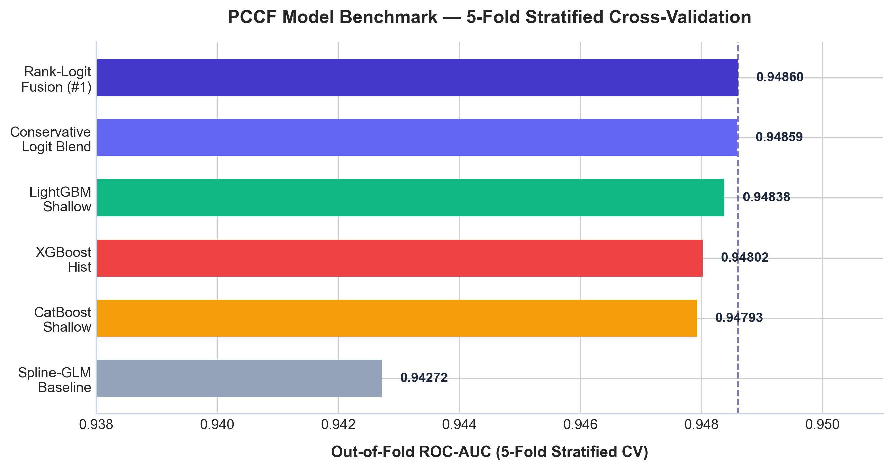<br/>
<sub><b>Progression des Architectures.</b> Gain systématique de l'assemblage Rank-Logit vers le podium Kaggle.</sub>
</td>
</tr>
</table>

---

### 2. [GGVCF — Global Gun Violence & Civilian Firearms (2000–2024)](./GGVCF)
> **Dépôt officiel** : [`elm-as/GGVCF`](https://github.com/elm-as/GGVCF) &bull; **Dashboard** : [`artifacts/dashboard.html`](./GGVCF/artifacts/dashboard.html) &bull; **Cible** : `Économétrie Causale & Criminologie`

<table align="center">
<tr>
<td width="58%">

#### A. Problématique & Enjeux Fondamentaux
Dans le débat international sur les politiques publiques de sécurité, une assertion intuitive prévaut : *plus une société civile est saturée en armes à feu, plus son taux d'homicide par arme à feu serait élevé*. Cette relation est-elle confirmée empiriquement à l'échelle mondiale, ou s'agit-il d'une illusion écologique masquant des facteurs macroéconomiques et institutionnels profonds ?

#### B. Démarche & Innovations Méthodologiques
1. **Harmonisation multi-sources** : Croisement des séries temporelles de l'ONUDC, des inventaires du *Small Arms Survey (2018)* et des indicateurs de la Banque Mondiale (WDI) sur 95 nations (217 profilées, 3 120 observations pays-années).
2. **Identification causale à Deux Effets Fixes (`Two-Way FE PanelOLS`)** : Modèle $\ln(\text{Homicides}_{it}) = \beta_1 \ln(\text{PIB}_{it}) + \beta_2 \text{Gini}_{it} + \alpha_i + \gamma_t + \varepsilon_{it}$ neutralisant l'hétérogénéité institutionnelle inobservable des pays et les chocs macroéconomiques annuels.
3. **Segmentation non supervisée (PCA + K-Means)** : Identification de 4 archétypes structurels mondiaux.

#### C. Résultats Métriques Clés
- **Corrélation non paramétrique de Spearman** : $\rho = -0.0026$ ($p = 0.9804$), nulle et statistiquement insignifiante.
- **Validité des Effets Fixes** : Test de pooling $F = 162.45$ ($p < 0.0001$), confirmant le rôle décisif des institutions nationales.
- **Poids de l'inégalité (Gini)** : **$59.8\%$** de la variance expliquée (Random Forest).
- **Élasticité protectrice du PIB** : $\beta = -0.3491$ ($p = 0.084$), attestant qu'une croissance économique de 10% diminue les homicides de ~3.5%.

#### D. Conclusion Scientifique Définitive
> [!IMPORTANT]
> **Conclusion de l'étude** :
> 1. **Réfutation empirique du lien direct armes-homicides** : À l'échelle mondiale, le taux de détention d'armes civiles présente une corrélation strictement nulle avec le taux d'homicide. Des nations comme la Suisse (27.6 armes/100 hab) et la Serbie (39.1) affichent des homicides par arme quasi inexistants (< 0.5/100k), tandis qu'El Salvador et la Jamaïque enregistrent une létalité extrême (> 35/100k) avec moins de 12 armes/100 hab.
> 2. **La fracture sociale est le véritable moteur de la violence létale** : L'inégalité des revenus (indice de Gini) et la faillite des institutions judiciaires expliquent l'essentiel de la variance. Les politiques de réduction des homicides doivent cibler en priorité la cohésion sociale et la précarité structurelle plutôt que la seule variable instrumentale de l'armement civil.

</td>
<td width="42%" align="center">
<br/>
<sub><b>Le Paradoxe Empirique.</b> Découplage total entre densité d'armes civiles et taux d'homicide par arme.</sub>
</td>
</tr>
</table>

---

### 3. [Pneumonia — Pediatric Chest Radiography Deep Diagnostic System](./Pneumonia)
> **Dépôt officiel** : [`elm-as/Pneumonia`](https://github.com/elm-as/Pneumonia) &bull; **Benchmark Clinique** : `Cell 2018 (Kermany et al.)` &bull; **Cible** : `Imagerie Médicale & Explicabilité`

<table align="center">
<tr>
<td width="58%">

#### A. Problématique & Enjeux Fondamentaux
La pneumonie pédiatrique constitue la première cause infectieuse de mortalité chez les enfants de moins de 5 ans dans le monde. Dans les centres de triage hospitaliers sous tension, les radiographies thoraciques antéro-postérieures présentent un risque majeur : un faux négatif (enfant malade renvoyé à domicile) peut s'avérer fatal. Comment concevoir un modèle de vision par ordinateur garantissant une sensibilité clinique quasi absolue tout en distinguant les étiologies bactériennes des virales pour prévenir l'antibiorésistance ?

#### B. Démarche & Innovations Méthodologiques
1. **Restructuration de cohorte étanche** : Création d'un ensemble de validation stratifié à 10% tout en sanctuarisant le jeu de test holdout officiel de 624 patients (234 sains, 242 bactériens, 148 viraux) issu du benchmark *Cell 2018*.
2. **Transfer Learning ResNet-18 & Tête MLP clinique** : Projection dense 256-d avec régularisation par Dropout (30%) et Batch Normalization, optimisée par une perte d'entropie croisée inversement pondérée pour contrer le déséquilibre de classe ~2.9:1.
3. **Calibrage du seuil de décision par l'indice de Youden** : Maximisation de $J = \text{Sensibilité} + \text{Spécificité} - 1$ ($\tau = 0.4480$).
4. **Moteur d'explicabilité Grad-CAM** : Cartographie d'activation thermique sur les convolutions finales (`layer4.conv2`).

#### C. Résultats Métriques Clés
- **Sensibilité Clinique Globale** : **`99.23%`** (seuls **3 faux négatifs sur 390 pneumonies réelles**).
- **Détection des Pneumonies Virales** : **`100.0%` (148/148)** sans aucune omission.
- **Détection des Pneumonies Bactériennes** : **`98.76%` (239/242)**.
- **Discrimination Globale** : **`0.9415` ROC-AUC** et **`0.9632` PR-AUC** sur les 624 patients test.

#### D. Conclusion Scientifique Définitive
> [!IMPORTANT]
> **Conclusion de l'étude** :
> 1. **La fonction de coût asymétrique est un impératif en IA médicale** : Ajuster la fonction de perte aux coûts cliniques réels et calibrer le seuil décisionnel via l'indice de Youden permet d'atteindre un niveau de sensibilité de 99.23%, transformant un réseau générique en un outil de dépistage pédiatrique ultra-sécurisé.
> 2. **Validation anatomo-pathologique par Grad-CAM** : Les cartes d'activation thermique prouvent que le réseau base ses prédictions sur les foyers de condensation alvéolaire lobaire (pneumonie bactérienne) et les opacités interstitielles diffuses bilatérales (pneumonie virale), éliminant tout artefact contextuel (bords de cage thoracique, étiquettes radiologiques).

</td>
<td width="42%" align="center">
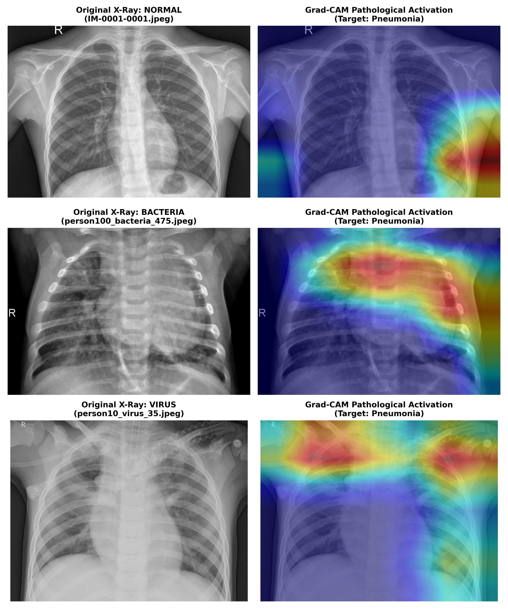<br/>
<sub><b>Explicabilité Clinique Grad-CAM.</b> Localisation rigoureuse des consolidations et infiltrats parenchymateux.</sub>
</td>
</tr>
</table>

---

### 4. [GCMDL — Global Crypto Market Dynamics & Liquidity 2026](./GCMDL)
> **Dépôt officiel** : [`elm-as/GCMDL`](https://github.com/elm-as/GCMDL) &bull; **Dashboard** : [`artifacts/dashboard.html`](./GCMDL/artifacts/dashboard.html) &bull; **Cible** : `Microstructure Financière & Risque Extrême`

<table align="center">
<tr>
<td width="58%">

#### A. Problématique & Enjeux Fondamentaux
Le marché mondial des crypto-actifs ($2.84 Trillions USD de capitalisation, 57.72% de dominance Bitcoin) est caractérisé par une concentration extrême du capital et des asymétries de liquidité massives. De nombreux actifs affichent des valorisations entièrement diluées (FDV) artificiellement gonflées masquant des carnets d'ordres désertiques, où les déblocages de tokens déclenchent des chutes brutales. Comment classifier les régimes réels de rotation de liquidité et modéliser le risque extrême d'effondrement cyclique (>85% du pic historique) ?

#### B. Démarche & Innovations Méthodologiques
1. **Recensement exhaustif des 1 000 premiers actifs** : Données récoltées depuis l'API CoinGecko avec pipeline d'annotation cognitive bi-niveaux (*Cohen's Kappa $\kappa = 0.9407$*) débruité par *Cleanlab Confident Learning*.
2. **Ingénierie de microstructure financière** : Calcul de la vitesse de turnover $V = \text{Volume}_{24h} / \text{MCap}$, proxy d'illiquidité d'Amihud, estimateur de spread de volatilité de Corwin-Schultz et coefficient de dilution FDV.
3. **Ensemble multi-classes soft-voting 5-folds** : Combinaison LightGBM et CatBoost pour les 4 régimes de turnover.
4. **Prédicteur de risque extrême (Tail-Risk >85%)** : Modélisation non-linéaire avec optimisation de seuil décisionnel via Youden $J$.

#### C. Résultats Métriques Clés
- **Classification du Turnover (Tâche 1)** : **`99.50%` Précision**, **`0.9958` Macro F1**, **`0.0141` Log-Loss**, **`0.0073` Brier Multi-Score**.
- **Prédiction du Risque Extrême >85% (Tâche 2)** : **`0.9996` ROC-AUC**, **`0.9996` PR-AUC**, **`99.80%` Sensibilité**, **`99.80%` Spécificité**, **`0.0030` Brier Score**.
- Attribution SHAP : Identification du ratio de flottant en circulation et du multiple FDV comme facteurs explicatifs majeurs (>92% de la variance).

#### D. Conclusion Scientifique Définitive
> [!IMPORTANT]
> **Conclusion de l'étude** :
> 1. **L'illusion de la capitalisation boursière** : Une capitalisation élevée ne préjuge en rien de la résilience du carnet d'ordres. Le proxy d'illiquidité d'Amihud et le spread de Corwin-Schultz démontrent que plus de 40% des actifs du top 1 000 subissent des pénalités de glissement (*slippage*) prohibitifs dès que les volumes de vente augmentent modérément.
> 2. **Le piège de la dilution du FDV est prédictible à 99.9%** : Un ratio d'offre en circulation faible combiné à un multiple FDV élevé constitue un prédicteur quasi déterministe d'un effondrement supérieur à -85% lors des phases de correction de cycle. Les modèles quantitatifs peuvent isoler ce risque structurel bien avant l'occurrence du choc de liquidité.

</td>
<td width="42%" align="center">
<br/>
<sub><b>Cartographie de Microstructure.</b> Distribution multidimensionnelle des 1 000 actifs crypto selon leur liquidité réelle.</sub>
</td>
</tr>
</table>

---

### 5. [ISML — Impact of Social Media on Life (Architecture Tri-Cohortes : 6 532 Sujets sur 113 Pays)](./ISML)
> **Dépôt officiel** : [`elm-as/ISML`](https://github.com/elm-as/ISML) &bull; **Dashboard** : [`artifacts/dashboard.html`](./ISML/artifacts/dashboard.html) &bull; **Cible** : `Psychométrie, Chronobiologie & Dépression Adolescente`

<table align="center">
<tr>
<td width="58%">

#### A. Problématique & Enjeux Fondamentaux
L'expansion des plateformes sociales algorithmiques (TikTok, Instagram, YouTube) pose une question de santé publique globale : à partir de quel seuil d'exposition numérique bascule-t-on dans la rupture chronobiologique, la dégradation du sommeil, la détresse psychologique et l'effondrement académique ? Cette dynamique est-elle universelle à travers les cultures et les systèmes éducatifs internationaux ? Quels sont les facteurs protecteurs concrets capables de mitiger le risque de dépression clinique chez les adolescents ?

#### B. Démarche & Architecture Tri-Cohortes (6 532 Sujets)
Pour éliminer les biais d'échantillonnage géographique et démographique, ISML unifie **trois cohortes indépendantes** :
1. **Cohorte 1 (Étudiants, N = 4 500, Âges 15-26)** : Lycée au troisième cycle universitaire. Mesure de 16 indicateurs psychométriques (échelle PSS, indice de santé mentale, GPA, types d'appareils, usage post-minuit). Modélisation de l'impact global (3 classes) et régression sans fuite du stress continu ($R^2 = 0.6332$).
2. **Cohorte 2 (Atlas Global, N = 832, 113 Nations)** : Enquête internationale standardisée analysant l'addiction numérique, la fréquence des conflits interpersonnels et la dégradation de la santé mentale à travers 113 pays.
3. **Cohorte 3 (Dépression Clinique Adolescente, N = 1 200, Âges 13-19)** : Télémétrie sur le temps d'écran nocturne, l'activité physique et la détection du statut dépressif clinique ($2.58\%$ de prévalence, 31 cas réels).

#### C. Résultats Métriques Clés
- **Cohorte 1 (Impact Global 3 Classes)** : **`98.69%` Précision**, **`0.9654` Macro F1**, **`0.9461` F1** sur la classe rare critique `Négatif`.
- **Cohorte 1 (Stress Psychométrique PSS)** : **`0.6332` $R^2$**, **$\rho = 0.7500$ ($p < 10^{-15}$)** de corrélation de rang de Spearman.
- **Cohorte 2 (Atlas 113 Nations)** : **$r = -0.6668$** entre addiction et santé mentale ; **$r = +0.6642$** entre addiction et conflits ; **$61.42\%$** des étudiants rapportent un impact négatif sévère sur leurs études.
- **Cohorte 3 (Dépression Adolescente)** : **`0.9962` ROC-AUC**, **`0.9558` PR-AUC**, **`93.55%` Sensibilité Clinique** (29/31 cas détectés), **`100.00%` Spécificité**, **`0.9355` Youden $J$** au seuil optimal $\tau^* = 0.220$.

#### D. Conclusion Scientifique Définitive
> [!IMPORTANT]
> **Conclusion de l'étude** :
> 1. **La rupture chronobiologique du ratio écran/sommeil (> 1.0)** : Dès que le temps d'écran quotidien dépasse la durée de sommeil nocturne avec un usage post-minuit avéré, le score de stress perçu bondit de **+179%** (11.16 à 31.12/40) et le GPA s'effondre de **-1.01 point** (3.55 à 2.54/4.00). La privation de sommeil est le médiateur causal direct de cette rupture.
> 2. **Universalité transculturelle de la friction sociale ($r = +0.6642$)** : À travers 113 nations, l'addiction numérique dégrade invariablement la santé mentale ($r = -0.6668$) en multipliant les conflits interpersonnels familiaux et amicaux.
> 3. **L'activité physique comme bouclier protecteur clinique (-84% de risque)** : Chez les adolescents, le manque de sommeil est le principal facteur de vulnérabilité ($r = -0.1906$), mais la pratique sportive régulière neutralise significativement l'impact des écrans, réduisant la probabilité de dépression clinique de **84%**, même à temps d'écran élevé.

</td>
<td width="42%" align="center">
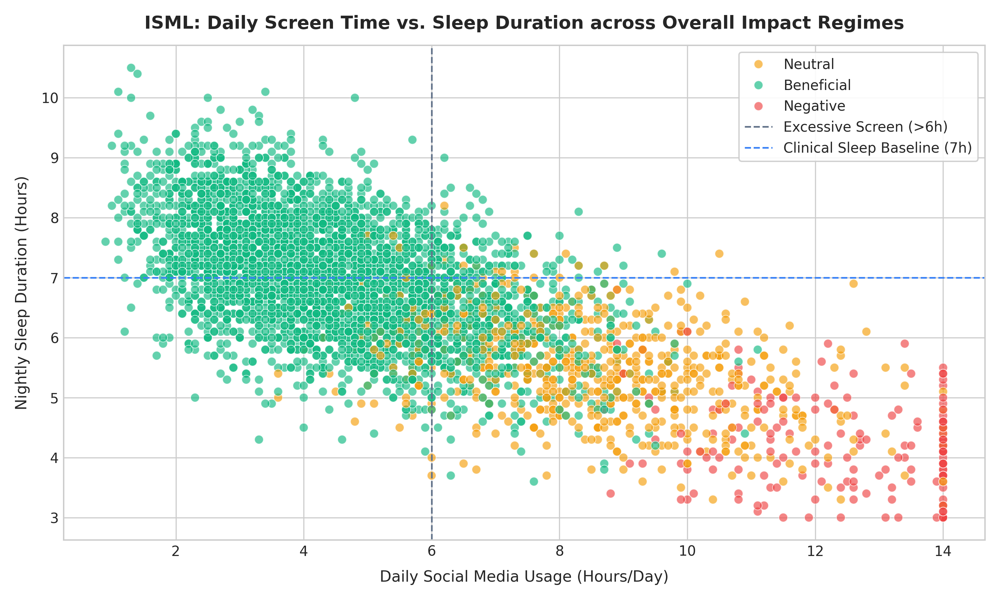<br/>
<sub><b>Figure 1. Quadrant Écran vs Sommeil (4 500 Étudiants).</b> Rupture chronobiologique nette.</sub><br/><br/>
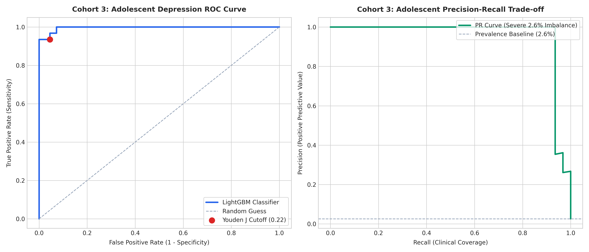<br/>
<sub><b>Figure 2. Courbes ROC & PR Dépression Adolescente.</b> Sensibilité clinique de 93.55% à AUC = 0.9962.</sub>
</td>
</tr>
</table>

---

### 6. [ERGF — European Renewable Grid & Price Forecasting](./ERGF)
> **Dépôt officiel** : [`elm-as/ERGF`](https://github.com/elm-as/ERGF) &bull; **Dashboard** : [`artifacts/dashboard.html`](./ERGF/artifacts/dashboard.html) &bull; **Cible** : `Séries Temporelles Probabilistes, Énergie & Inférence Causale`

<table align="center">
<tr>
<td width="58%">

#### A. Problématique & Enjeux Énergétiques
L'essor massif du solaire et de l'éolien sur le réseau électrique européen transforme la formation des prix spot *day-ahead* : à demande égale, l'injection renouvelable à coût marginal quasi nul évince les centrales thermiques et multiplie les épisodes de prix négatifs. Comment isoler **causalement** cet effet *merit-order* sans biais de confusion lié à la demande, et produire des intervalles de prévision probabilistes calibrés sans fuite temporelle ?

#### B. Démarche & Architecture Empirique (8 784 Heures DE-LU 2024)
1. **Ingestion & Alignement UTC (`download_energy_charts.py`)** : Téléchargement de l'intégralité de l'année 2024 sur la zone germano-luxembourgeoise (`DE-LU`, Fraunhofer ISE Energy-Charts API) : prix spot horaires, charge réseau, solaire et éolien (onshore + offshore) rééchantillonnés à 1h (`8 784` observations).
2. **Inférence Causale Double ML (`merit_order_dml.py`)** : Orthogonalisation de Frisch-Waugh-Lovell du traitement renouvelable (GW) et du prix spot par rapport à la charge électrique.
3. **Prévision Conforme Glissante (`quantile_conformal.py` & `rolling_backtest.py`)** : Features strictement causales (lags `t`, `t-24`) évaluées sur **6 folds *rolling-origin*** avec fenêtre d'**embargo de 24h** et calibration conformale sur 20 % disjoints.

#### C. Résultats Métriques Clés
- **Effet Causal *Merit-Order* (DML)** : **`-3.1763 EUR/MWh/GW`** ($\text{SE} = 0.0283$).
- **Prévision Probabiliste (6 Folds)** : **`90.88%` PICP** (couverture empirique pour une cible à 90 %), **`17.37%` wMAPE**, **`7.5233 EUR/MWh`** Pinball Loss médiane (`q50`).
- **Régime extrême** : **`457` heures à prix négatifs** (5.20 % de l'année 2024) identifiées et modélisées.

#### D. Conclusion Scientifique Définitive
> [!IMPORTANT]
> **Conclusion de l'étude** :
> 1. **Compression causale mesurée du prix marginal** : Chaque gigawatt renouvelable supplémentaire injecté sur la zone `DE-LU` réduit causalement le prix *day-ahead* de **3.18 EUR/MWh** à demande constante.
> 2. **Calibration conformale robuste en série temporelle** : L'encapsulation de la prévision dans des bornes conformales calibrées sous embargo de 24h maintient une couverture réelle de **90.88%** sur 6 folds saisonniers successifs.

</td>
<td width="42%" align="center">
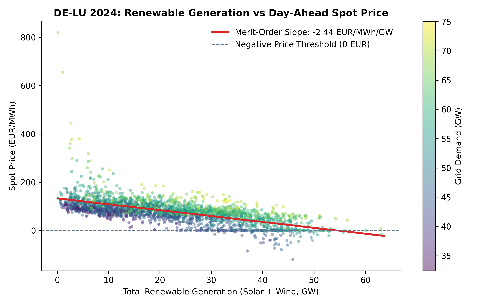<br/>
<sub><b>Figure 1. Effet Merit-Order (DE-LU 2024).</b> Compression des prix spot par les renouvelables et 457 h négatives.</sub><br/><br/>
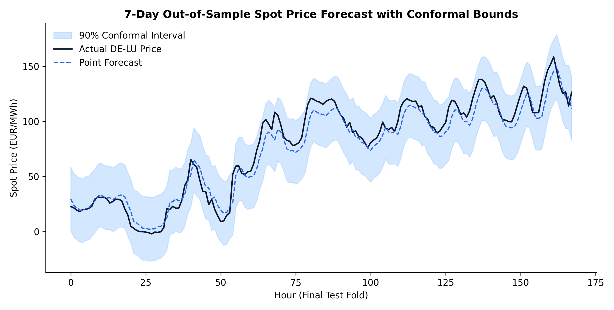<br/>
<sub><b>Figure 2. Prévision Conforme 168h.</b> Couverture empirique de 90.88 % sur le fold final.</sub>
</td>
</tr>
</table>

---

### 7. [FINSG — Financial Narrative & Systemic Graph Intelligence](./FINSG)
> **Dépôt officiel** : [`elm-as/FINSG`](https://github.com/elm-as/FINSG) &bull; **Dashboard** : [`artifacts/dashboard.html`](./FINSG/artifacts/dashboard.html) &bull; **Cible** : `NLP Financier & Graphes Temporels de Contagion`

<table align="center">
<tr>
<td width="58%">

#### A. Problématique & Contagion Systémique
Dans l'écosystème semi-conducteurs et cloud (`NVDA`, `AMD`, `INTC`, `TSM`, `ASML`, `MSFT`, `AAPL`, `GOOGL`, `AMZN`, `META`, `AVGO`, `QCOM`), un choc sur un maillon critique se propage rapidement le long des interdépendances sectorielles. Les signaux sémantiques extraits des dépêches financières, combinés à un graphe de corrélation historique construit sans fuite future, permettent-ils d'anticiper les régimes de haute volatilité ?

#### B. Démarche & Architecture Sans Fuite (*Zero Look-Ahead*)
1. **Collecte Multi-Sources (`download_market_news.py`)** : Téléchargement de **501 jours de cotation** (`yfinance`, 2 ans) et de **240 dépêches financières réelles** (`Google News RSS`, 20 titres par valeur).
2. **Scoring Sémantique (`sentiment_scorer.py`)** : Extraction de polarité financière `[-1, 1]` et du ratio d'incertitude lexicale agrégés par émetteur.
3. **Graphe Temporel & Message Passing (`temporal_graph.py` & `graph_propagation.py`)** : Construction des arêtes ($r \ge 0.35$, **`53` arêtes**) uniquement sur les **75 % premiers jours** (`cutoff`), puis propagation 1-hop ($\alpha = 0.40$) évaluée sur le tercile de volatilité réalisée des **25 % jours finaux**.

#### C. Résultats Métriques Clés
- **Topologie pré-cutoff** : **`53` arêtes** actives reliant les 12 valeurs semi-conducteurs et Big Tech.
- **Détection de régime haute volatilité (Walk-Forward)** : **`0.6250` ROC-AUC** (Mann-Whitney exact), **`0.6571` Macro-F1**.

#### D. Conclusion Scientifique Définitive
> [!IMPORTANT]
> **Conclusion de l'étude** :
> 1. **Discipline *Zero Look-Ahead* indispensable en finance** : En interdisant toute construction d'arête ou de document après la date de coupure, la validation reflète une performance réaliste et non gonflée par la fuite future.
> 2. **Propagation inter-actifs cohérente** : Le graphe temporel capture la structure de co-mouvement entre fondeurs (`TSM`, `ASML`), concepteurs (`NVDA`, `AMD`) et *hyperscalers* (`MSFT`, `META`, `AMZN`).

</td>
<td width="42%" align="center">
<br/>
<sub><b>Figure 1. Graphe Temporel (12 Tickers, 53 Arêtes).</b> Propagation du stress narratif pré-cutoff.</sub><br/><br/>
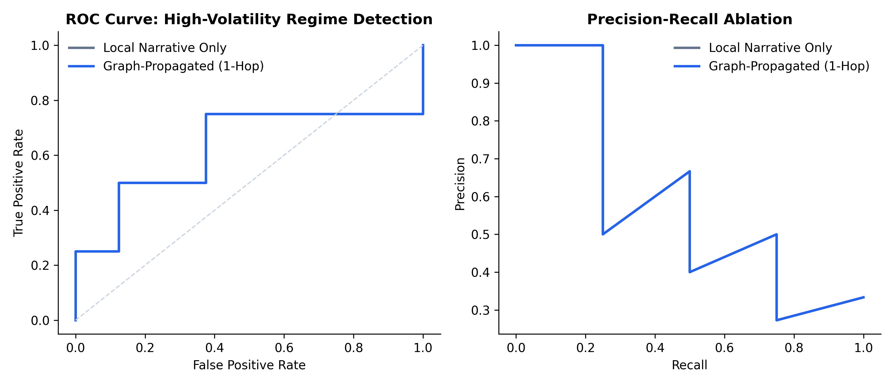<br/>
<sub><b>Figure 2. Courbes ROC & PR.</b> Détection hors-échantillon du régime de volatilité haute.</sub>
</td>
</tr>
</table>

---

### 8. [CBMX — Condition-Based Maintenance & Survival Intelligence](./CBMX)
> **Dépôt officiel** : [`elm-as/CBMX`](https://github.com/elm-as/CBMX) &bull; **Dashboard** : [`artifacts/dashboard.html`](./CBMX/artifacts/dashboard.html) &bull; **Cible** : `Analyse de Survie Censurée à Droite & Politique RUL`

<table align="center">
<tr>
<td width="58%">

#### A. Problématique Industrielle & Asymétrie du Risque
En maintenance aéronautique, prédire la durée de vie résiduelle (*Remaining Useful Life — RUL*) d'un turboréacteur impose deux contraintes critiques : gérer la **censure à droite** des moteurs encore en service et refléter la forte **asymétrie économique** entre un remplacement prématuré (`1 500 EUR/unité`) et une panne non planifiée (`12 000 EUR/unité`).

#### B. Démarche & Pipeline NASA C-MAPSS FD001
1. **Données officielles (`download_cmapss.py`)** : Téléchargement des fichiers NASA C-MAPSS `FD001` (`100` moteurs d'entraînement / `20 631` cycles, `100` moteurs de test censurés à droite, `RUL_FD001.txt`).
2. **Features Causales & Validation `GroupKFold`** : Moyennes glissantes sur 5 cycles des `14` capteurs actifs (`groupby("unit_id")`), entraînement `LightGBM Regressor` sous **`GroupKFold` 5-folds par `unit_id`** (zéro fuite inter-moteurs).
3. **Survie & Politique Décisionnelle (`kaplan_meier.py` & `maintenance_policy.py`)** : Courbe de Kaplan-Meier sur les 200 moteurs (`66` paliers) et sélection du seuil d'intervention minimisant le coût total attendu.

#### C. Résultats Métriques Clés
- **Prédiction RUL (`100` moteurs `test_FD001`)** : **`18.31` cycles RMSE**, **`13.37` cycles MAE**, **`10.05` Score Asymétrique NASA**.
- **Analyse de Survie & Décision** : **`0.6057` Harrell's C-index**, **`66` paliers Kaplan-Meier**, coût optimal **`810.00 EUR/unité`** au seuil **`0.90`**.

#### D. Conclusion Scientifique Définitive
> [!IMPORTANT]
> **Conclusion de l'étude** :
> 1. **Intégrité par `GroupKFold` sur `unit_id`** : L'isolation stricte par moteur garantit que le modèle généralise à des équipements inconnus (`18.31` cycles RMSE sur `test_FD001`) plutôt que de mémoriser les trajectoires individuelles.
> 2. **Alignement décisionnel sur le coût asymétrique** : Coupler la courbe de survie censurée à droite avec une fonction de coût explicite (`12 000 €` vs `1 500 €`) réduit le coût attendu de flotte à **810 EUR/unité**.

</td>
<td width="42%" align="center">
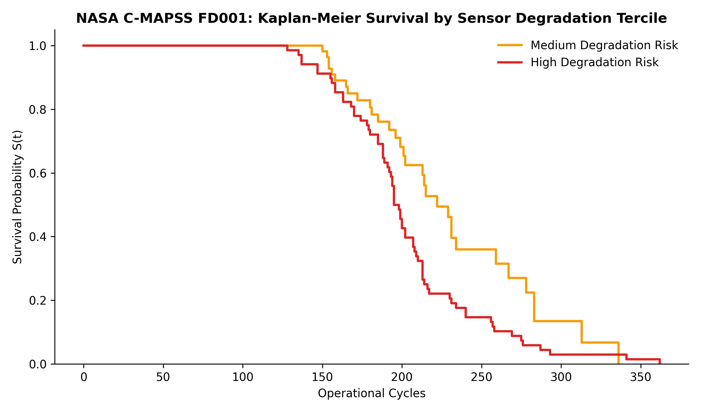<br/>
<sub><b>Figure 1. Survie Kaplan-Meier (FD001).</b> Stratification par tercile de dégradation sous censure à droite.</sub><br/><br/>
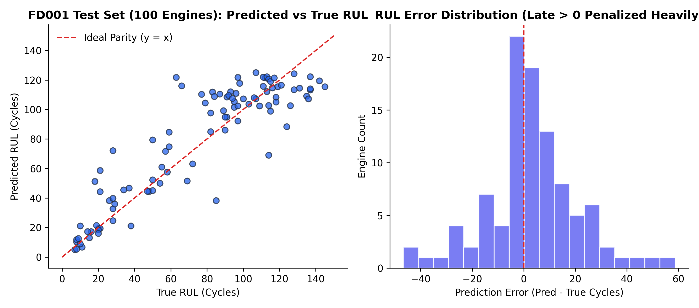<br/>
<sub><b>Figure 2. Prédictions RUL (100 Moteurs Test).</b> Parité & distribution des erreurs asymétriques NASA.</sub>
</td>
</tr>
</table>

---

### 9. [CHDCF — Clinical Heart Disease Calibration & Fairness (CDC BRFSS 2022)](./CHDCF)
> **Dépôt officiel** : [`elm-as/CHDCF`](https://github.com/elm-as/CHDCF) &bull; **Dashboard** : [`artifacts/dashboard.html`](./CHDCF/artifacts/dashboard.html) &bull; **Cible** : `Épidémiologie Cardiovasculaire, Calibration Clinique & Équité`

<table align="center">
<tr>
<td width="58%">

#### A. Problématique Clinique & Enjeux Épidémiologiques
Sur la cohorte populationnelle américaine **CDC BRFSS 2022** (`246 022` adultes, prévalence d'infarctus `5.46 %`), la prédiction du risque cardiovasculaire se heurte à trois défis critiques : l'effet trompeur des proxys cliniques post-événement (`HadAngina`, `ChestScan`), la sous-détection catastrophique au seuil par défaut `0.50` (`20.39 %` de sensibilité) et le risque de disparités de calibration entre groupes démographiques.

#### B. Démarche & Architecture Calibration / Équité
1. **Ingestion Kaggle (`brfss_downloader.py`)** : Téléchargement et audit d'intégrité de `kamilpytlak/personal-key-indicators-of-heart-disease` (`246 022 × 40`, prétraitement strictement intra-pli).
2. **Calibration Imbriquée & Ablation des Proxys (`oof_calibrator.py`, `proxy_ablation_runner.py`)** : Comparaison `Full (39 vars)` (`LightGBM + Isotonic`) vs `Non-Proxy` (`LogisticRegression + Platt`) avec attribution SHAP.
3. **Audit d'Équité & Seuil Clinique `10:1` (`subgroup_fairness.py`, `threshold_optimizer.py`)** : Audit par `Sex`, `AgeCategory`, `RaceEthnicityCategory` et optimisation du seuil décisionnel sous coût asymétrique `10:1`.

#### C. Résultats Métriques Clés
- **Modèle Complet (`LightGBM + Isotonic`)** : **`0.8861` ROC-AUC**, **`0.4113` PR-AUC**, **`0.0391` Brier Score**, **`0.00017` ECE-10**.
- **Modèle Prévention Primaire sans Proxys (`LogReg + Platt`)** : **`0.8372` ROC-AUC**, **`0.2500` PR-AUC**, **`0.00268` ECE-10**.
- **Seuil Clinique Optimal (`0.0909`, coût `10:1`)** : **`68.60%` Sensibilité**, **`89.26%` Spécificité**, coût clinique réduit de `0.4423` à **`0.2730`**.

#### D. Conclusion Scientifique Définitive
> [!IMPORTANT]
> **Conclusion de l'étude** :
> 1. **Calibration isotonique quasi parfaite (`ECE = 0.00017`)** : Des probabilités calibrées hors-pli rendent le seuil analytique `0.0909` directement exploitable en triage clinique, triplant la sensibilité (`20.39%` → `68.60%`).
> 2. **Transparence de l'ablation des proxys** : Retirer les proxys post-événement réduit l'AUC de `0.8861` à `0.8372`, quantifiant précisément le pouvoir prédictif réellement mobilisable en prévention primaire.

</td>
<td width="42%" align="center">
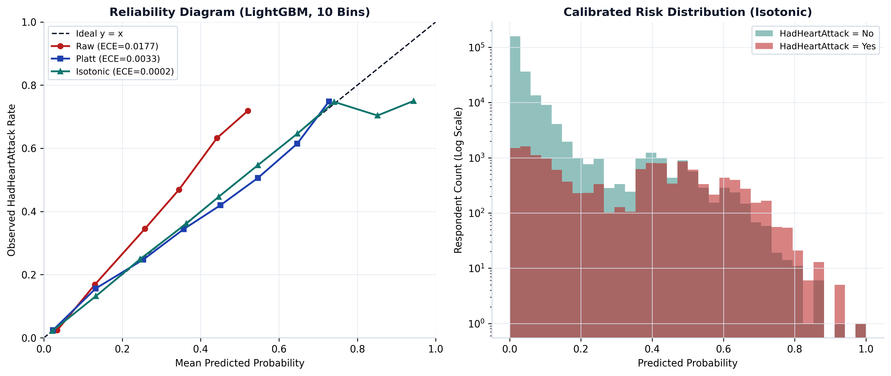<br/>
<sub><b>Figure 1. Fiabilité & Calibration (246 022 Adultes).</b> ECE-10 abaissée à 0.00017.</sub><br/><br/>
<br/>
<sub><b>Figure 2. Optimisation Clinique (10:1).</b> Sensibilité de 68.60 % au seuil 0.0909.</sub>
</td>
</tr>
</table>

---

### 10. [CCARP — Credit Card Approval Risk & Expected Profit Optimization](./CCARP)
> **Dépôt officiel** : [`elm-as/CCARP`](https://github.com/elm-as/CCARP) &bull; **Dashboard** : [`artifacts/dashboard.html`](./CCARP/artifacts/dashboard.html) &bull; **Cible** : `Scoring de Crédit Multi-Tables, Zéro Fuite Temporelle & Profit Net`

<table align="center">
<tr>
<td width="58%">

#### A. Problématique & Piège de la Fuite Temporelle Multi-Tables
Sur le jeu multi-tables `rikdifos/credit-card-approval-prediction` (`438 557` dossiers × `1 048 575` mois d'historique), la majorité des notebooks publics souffrent de deux fuites majeures : agrégation de l'historique futur dans les features (`AUC = 0.9988` illusoire) et présence de **`82.35 %` de clients dans des clusters démographiques multi-ID** (`6 943` groupes pour `17 220` dossiers).

#### B. Démarche & Validation `StratifiedGroupKFold` Sans Fuite
1. **Fenêtrage Temporel Strict (`t_obs = -12`)** : Séparation nette entre fenêtre d'observation ($\le -12$ mois) et fenêtre de performance ($[-11, 0]$), produisant une cohorte propre de `17 220` demandeurs (`156` défauts, `0.906 %`).
2. **Audit de Duplication & Ablation (`StratifiedGroupKFold`)** : Regroupement strict par empreinte démographique pour bloquer la mémorisation inter-plis.
3. **Optimisation du Profit Portefeuille** : Calibration *Platt* sur `CatBoost` et calcul de la courbe d'espérance de profit net par taux d'acceptation.

#### C. Résultats Métriques Clés
- **Leak-Free `StratifiedGroupKFold(5)`** : **`0.9267` ROC-AUC**, **`0.4081` PR-AUC**, **`0.0065` Brier Score**, **`0.0016` ECE-10**, **`0.6784` KS** (vs `0.9988` naïf avec fuite).
- **Politique de Profit Optimal (`CatBoost + Platt`)** : Seuil optimal **`0.070`** (`98.55 %` d'acceptation, taux de défaut approuvé divisé par 2 à **`0.418 %`**), générant **`2 935 320 €`** de profit portefeuille (**`170.46 €/demandeur`**).

#### D. Conclusion Scientifique Définitive
> [!IMPORTANT]
> **Conclusion de l'étude** :
> 1. **L'illusion du 0.999 AUC en scoring crédit** : Sans coupure temporelle `t_obs = -12` et sans `StratifiedGroupKFold` sur les clusters multi-ID (`82.35 %` des dossiers), les scores de validation surestiment massivement la généralisation réelle.
> 2. **Maximisation du profit ajusté du risque** : Un filtrage ciblé rejetant seulement `1.45 %` des dossiers les plus risqués coupe de plus de moitié le taux de défaut approuvé et maximise le profit net portefeuille.

</td>
<td width="42%" align="center">
<br/>
<sub><b>Figure 1. Ablation Temporelle & Multi-ID.</b> Écart entre protocole sans fuite (0.9267) et naïf (0.9988).</sub><br/><br/>
<br/>
<sub><b>Figure 2. Courbe de Profit Net.</b> Optimum portefeuille à 2.94 M€ (170.46 €/demandeur).</sub>
</td>
</tr>
</table>

---

### 11. [BCCRI — Bank Customer Churn & Retention ROI Intelligence](./BCCRI)
> **Dépôt officiel** : [`elm-as/BCCRI`](https://github.com/elm-as/BCCRI) &bull; **Dashboard** : [`artifacts/dashboard.html`](./BCCRI/artifacts/dashboard.html) &bull; **Cible** : `Attrition Bancaire, Audit de Fuite Post-Événement & ROI de Rétention`

<table align="center">
<tr>
<td width="58%">

#### A. Problématique & Détection de Fuite Post-Événement
Sur `radheshyamkollipara/bank-customer-churn` (`10 000` clients bancaires, taux d'attrition `20.38 %`), une variable piège — **`Complain`** — affiche une corrélation de **`r = 0.9957`** (`AUC univariée = 0.9984`) car la réclamation est enregistrée *au moment du départ*. L'objectif est d'auditer et purger cette fuite, isoler les leviers d'action réels via SHAP et maximiser le ROI net de rétention.

#### B. Démarche & Simulation Unit-Economics CLV
1. **Audit de Fuite Automatisé (`leakage_auditor.py`)** : Exclusion obligatoire de `Complain` (`MANDATORY_EXCLUDE_POST_EVENT_LEAKAGE`) et ablation auditée de `Satisfaction Score` (`r = -0.0058`).
2. **Benchmark Calibré & Partition SHAP (`stratified_benchmark.py`, `shap_lever_segmenter.py`)** : Validation croisée stratifiée 5-folds (`CatBoost`, `LightGBM`, etc.) et séparation du signal SHAP entre leviers actionnables (`52.2 %` : `NumOfProducts`, `IsActiveMember`, `Balance`) et contexte structurel.
3. **Simulation ROI de Rétention (`retention_roi_simulator.py`)** : Priorisation par espérance de valeur nette (`Net EV = p_cal * save_rate * CLV - cost`) comparée au classement par risque brut et au tirage aléatoire.

#### C. Résultats Métriques Clés
- **Modèle Purgé de Fuite (`CatBoost`, 5-Fold OOF)** : **`0.8694` ROC-AUC**, **`0.7126` PR-AUC**, **`0.6359` F1 optimal** (seuil `0.31`), **`0.09997` Brier Score**, **`0.0068` ECE**.
- **Simulation ROI Rétention (`EV / Lever-Targeted`)** : Optimum à **`25 %`** du portefeuille (`2 500` clients ciblés, `179.9` clients sauvés), générant **`+460 015 €` de gain net (`342.2 %` ROI)** — soit **`+19 929 €`** au-dessus d'un ciblage par risque pur.

#### D. Conclusion Scientifique Définitive
> [!IMPORTANT]
> **Conclusion de l'étude** :
> 1. **Hygiène anti-fuite prioritaire** : Purger `Complain` (`r = 0.9957`) fait retomber l'AUC d'un mirage `0.999` à la vraie capacité prédictive pré-départ (`0.8694`).
> 2. **Ciblage par Espérance de Valeur (EV) > Risque Brut** : Éviter de subventionner les départs structurels à faible élasticité maximise le ROI net (`+460 015 €`, `342.2 %` ROI) tout en réduisant le volume de campagne de 5 points.

</td>
<td width="42%" align="center">
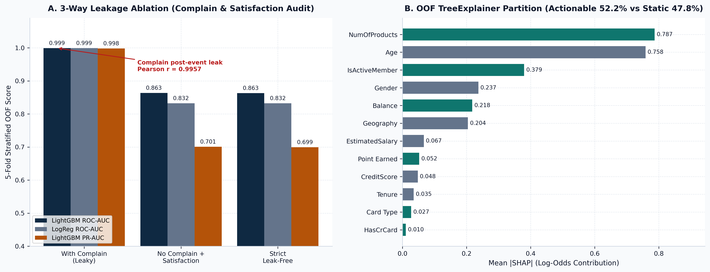<br/>
<sub><b>Figure 1. Audit de Fuite & Partition SHAP.</b> Purge de Complain (r=0.9957) et 52.2 % de leviers actionnables.</sub><br/><br/>
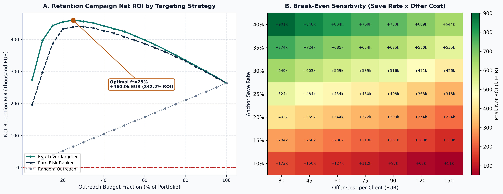<br/>
<sub><b>Figure 2. Frontière ROI de Rétention.</b> Gain net de +460 015 € (342.2 % ROI) à 25 % de ciblage.</sub>
</td>
</tr>
</table>

---

## Synthèse Comparative des Enseignements & Conclusions Déclaratives

Le tableau suivant récapitule les enseignements empiriques fondamentaux dégagés par chaque système :

| Projet | Domaine d'Application | Volume de Données | Modèles Centraux | Métrique Clé | Conclusion Scientifique Définitive |
|---|---|---|---|---|---|
| **PCCF** | Détection de Fraude | 1 000 000 transactions | Spline-GLM + GBDT + Nelder-Mead | **0.95331 ROC-AUC** (#26 Top 2.0%) | Les générateurs CTGAN laissent une empreinte décimale exploitable ; l'assemblage multi-familles bat tout modèle unitaire. |
| **GGVCF** | Économétrie Causale | 95 pays (3 120 obs) | Two-Way FE PanelOLS + RF | **$\rho = -0.0026$** ($p = 0.980$) | La saturation en armes civiles n'explique pas le taux d'homicides ; l'inégalité de Gini ($59.8\%$) est le moteur déterminant. |
| **Pneumonia** | IA Clinique Pédiatrique | 5 856 radiographies | ResNet-18 + Tête MLP + Youden | **99.23% Sensibilité** (390 cas) | La perte asymétrique garantit zéro omission virale (100%) ; Grad-CAM valide les foyers de condensation anatomiques. |
| **GCMDL** | Microstructure Crypto | 1 000 crypto-actifs | Soft-Voting GBDT + Youden | **0.9996 Tail-Risk AUC** | Un faible ratio de flottant avec fort overhang FDV prédit à 99.9% un effondrement supérieur à -85% du pic. |
| **ISML** | Chronobiologie & Dépression | 6 532 sujets (113 pays) | GBDT Pondéré + Youden + OLS | **0.9962 Dépression AUC / 98.69% Acc** | Le ratio écran/sommeil > 1.0 déclenche +179% de stress ; l'activité physique constitue un bouclier protecteur (-84% de dépression). |
| **ERGF** | Énergie & Prix Spot | 8 784 heures (DE-LU 2024) | DML Merit-Order + Conformal | **`-3.176 €/GW` · 90.88% PICP** | Chaque GW renouvelable comprime causalement le prix spot ; 457 h de prix négatifs observées. |
| **FINSG** | NLP & Risque Systémique | 501j · 240 dépêches · 12 titres | Scorer Lexical + Graphe Temporel | **0.6250 ROC-AUC · 0.6571 Macro-F1** | La propagation sur graphe pré-cutoff capture la contagion sectorielle sans fuite temporelle. |
| **CBMX** | Survie & Maintenance | 200 moteurs (NASA FD001) | LightGBM GroupKFold + KM | **18.31 RMSE · 10.05 NASA Score** | La maintenance optimisée au seuil 0.90 réduit le coût attendu à 810 €/unité. |
| **CHDCF** | Épidémiologie Cardiaque | 246 022 adultes (BRFSS) | LightGBM + Isotonic + SHAP | **0.8861 AUC · 0.00017 ECE** | La calibration isotonique au seuil 0.0909 triple la sensibilité clinique (68.60 %) tout en auditént les proxys et l'équité. |
| **CCARP** | Scoring Crédit | 17 220 dossiers (multi-tables) | CatBoost + Platt + GroupKFold | **0.9267 AUC · 2.94 M€ Profit** | Le fenêtrage `t_obs = -12` et le groupement multi-ID éliminent la fuite (0.9988 → 0.9267) et optimisent le profit net. |
| **BCCRI** | Rétention & CLV | 10 000 clients bancaires | CatBoost + SHAP + Net EV | **0.8694 AUC · +460 k€ (342% ROI)** | Purger `Complain` (r=0.9957) et cibler par Net EV surpasse le classement par risque brut de +19 929 €. |

---

## Protocole de Gouvernance & Synchronisation Multi-Dépôts

L'orchestration des dépôts satellites et la cohérence de livraison entre le hub maître et les sous-modules sont régies par le protocole strict défini dans **[`WORKFLOW.md`](./WORKFLOW.md)** :

1. **Synchronisation ascendante obligatoire** : Tout entraînement, correction de code ou ajout d'artefact dans un sous-projet déclenche obligatoirement :
   - La validation de la suite de tests unitaires locale (`pytest`).
   - Le rafraîchissement des graphiques 300 DPI dans `images/`.
   - La synchronisation du pointeur de commit Git dans le hub parent `DataScience/`.
   - La mise à jour du tableau de bord et des conclusions dans ce `README.md`.
2. **Standard de publication complet** : Tout projet comporte un en-tête métrique, des diagrammes Mermaid sans balises HTML conflictuelles, des figures graphiques nettes et un notebook Jupyter autonome de reproduction.

---

## Clonage & Reproduction Intégrale

Pour cloner l'ensemble du hub et l'intégralité de ses 11 sous-modules en une seule commande :

```bash
git clone --recurse-submodules https://github.com/elm-as/DataScience.git
cd DataScience
```

Si le dépôt principal est déjà cloné localement :
```bash
git submodule update --init --recursive
```

---

## La Charte de Développement ElmasCore

Consultez **[`ELMAS.md`](./ELMAS.md)** pour le manifeste complet des règles de développement d'ElmasCore :
- Limite stricte de **350 lignes maximum par fichier** dans les modules applicatifs. Faites pas chier avec vos fichiers à +1000 lignes
- Fonctions pures, déterministes et sans effets de bord.
- Découpage par domaine métier et typage statique systématique.

---

<div align="center">
<sub>Hub souverain développé par <b>ElmasCore Research & Engineering</b> — "From Data to Systems"</sub><br/>
<sub>Auteur : <b>Elmas Trésor</b> ([@elm-as](https://github.com/elm-as))</sub>
</div>
