<div align="center">

# ElmasCore — Data Science & Competitive Machine Learning Hub
### Production Data Systems, Econometric Research, Medical Deep Learning & Financial Telemetry Architectures

<br/>


<br/>

**"From Data to Systems"**  
The master hub orchestrating production-grade data science initiatives, Kaggle competitive pipelines, causal econometric monographs, medical deep learning systems, and quantitative crypto telemetry.

</div>

<br/>

<table align="center">
<tr>
<td align="center"><h2>4</h2><sub>active systems</sub></td>
<td align="center"><h2>1,009,976</h2><sub>analyzed records</sub></td>
<td align="center"><h2>0.95331</h2><sub>PCCF Public (#26 Top 2.0%)</sub></td>
<td align="center"><h2>99.23%</h2><sub>Pneumonia Sensitivity</sub></td>
<td align="center"><h2>0.9996</h2><sub>GCMDL Tail-Risk ROC-AUC</sub></td>
<td align="center"><h2>100%</h2><sub>ELMAS.md compliant</sub></td>
</tr>
</table>

---

## Table of Contents

1. [Overview & Vision](#overview--vision)
2. [Hub Architecture & Git Submodules](#hub-architecture--git-submodules)
3. [Active Systems Showcase](#active-systems-showcase)
   - [PCCF — Predicting Credit Card Fraud (Kaggle S6E11)](#1-pccf--predicting-credit-card-fraud-kaggle-s6e11)
   - [GGVCF — Global Gun Violence & Civilian Firearms (2000–2024)](#2-ggvcf--global-gun-violence--civilian-firearms-20002024)
   - [Pneumonia — Pediatric Chest Radiography Deep Diagnostic System](#3-pneumonia--pediatric-chest-radiography-deep-diagnostic-system)
   - [GCMDL — Global Crypto Market Dynamics & Liquidity 2026](#4-gcmdl--global-crypto-market-dynamics--liquidity-2026)
4. [Protocole de Gouvernance & Synchronisation Multi-Dépôts](#protocole-de-gouvernance--synchronisation-multi-dépôts)
5. [Full Setup & Cloning](#full-setup--cloning)
6. [The ElmasCore Charter](#the-elmascore-charter)
7. [Author & Contact](#author--contact)

---

## Overview & Vision

`DataScience/` is not a loose collection of ad-hoc Jupyter notebooks. It is an industrial-grade **monorepo and submodule hub** where every project operates as an independent, fully tested, domain-driven package following the strict **[ELMAS.md](./ELMAS.md)** standard:
- **Strict 350-line ceiling per file**: Monolithic scripts are prohibited.
- **Dual documentation**: Every project ships with an illustrated, publication-grade `README.md` and an interactive walkthrough `notebook/`.

---

## Hub Architecture & Git Submodules

```mermaid
flowchart TD
    ROOT[DataScience Master Hub<br/>elm-as/DataScience] --> WORKFLOW[WORKFLOW.md<br/>Gouvernance & Synchronisation]
    ROOT --> CHARTER[ELMAS.md<br/>ElmasCore Quality Charter]
    ROOT --> SUB1[PCCF Submodule<br/>elm-as/PCCF]
    ROOT --> SUB2[GGVCF Submodule<br/>elm-as/GGVCF]
    ROOT --> SUB3[Pneumonia Submodule<br/>elm-as/Pneumonia]
    ROOT --> SUB4[GCMDL Submodule<br/>elm-as/GCMDL]

    SUB1 --> P_SRC[src/ Domain Architecture]
    SUB1 --> P_NB[notebooks/ Walkthrough]
    SUB1 --> P_SUB[submissions/ Rank-Logit Consensus]

    SUB2 --> G_SRC[src/ Econometric Models]
    SUB2 --> G_NB[notebooks/ Econometric Monograph]
    SUB2 --> G_DASH[artifacts/ Interactive Dashboard]

    SUB3 --> PN_SRC[src/ Medical CNN & Trainer]
    SUB3 --> PN_NB[notebooks/ Radiography Monograph]
    SUB3 --> PN_CAM[images/ Grad-CAM Heatmaps]

    SUB4 --> GC_SRC[src/ Microstructure & ML Ensembles]
    SUB4 --> GC_NB[notebooks/ Crypto Monograph]
    SUB4 --> GC_DASH[artifacts/ Interactive Dashboard & CLI]

    style ROOT fill:#EEF2FF,stroke:#6366F1,color:#1e1b4b
    style SUB1 fill:#ECFDF5,stroke:#10B981,color:#064e3b
    style SUB2 fill:#FEF3C7,stroke:#D97706,color:#78350F
    style SUB3 fill:#FCE7F3,stroke:#DB2777,color:#831843
    style SUB4 fill:#E0F2FE,stroke:#0284C7,color:#0c4a6e
```



---

## Active Systems Showcase

### 1. [PCCF — Predicting Credit Card Fraud (Kaggle S6E11)](./PCCF)
> **Dépôt officiel** : [`elm-as/PCCF`](https://github.com/elm-as/PCCF) &bull; **Kaggle Standing** : **`Rank #26 / 1,294 (Top 2.0%)`** &bull; **Public ROC-AUC** : **`0.95331`**

<table align="center">
<tr>
<td width="60%">

- **Objectif** : Détection de transactions frauduleuses hautement asymétriques sur plus de 1,000,000 d'observations réelles et synthétiques.
- **Innovations** :
  - Décomposition fine des décimales (`cents_key`, `tenth_key`, premier chiffre de Benford) capturant les artefacts de génération synthétique (CTGAN/Copula).
  - Target encoding cross-fitté 100% sans fuite avec lissage bayésien ($m=20.0$).
  - Ensemble multi-familles (Spline-GLM, LightGBM Shallow, CatBoost Shallow, XGBoost Hist) optimisé par Nelder-Mead Rank-Logit.
- **Résultats** : **`0.95331` Public ROC-AUC** sur le Leaderboard Kaggle (**Rank #26 / 1,294**, Top 2.0% mondial, distance au 1er : 2.7 points de base) via un consensus souverain multi-architectures.

</td>
<td width="40%" align="center">
<br/>
<sub><b>Performance du Blend.</b> Gain systématique de l'assemblage Rank-Logit.</sub>
</td>
</tr>
</table>

---

### 2. [GGVCF — Global Gun Violence & Civilian Firearms (2000–2024)](./GGVCF)
> **Dépôt officiel** : [`elm-as/GGVCF`](https://github.com/elm-as/GGVCF) &bull; **Dashboard** : [`artifacts/dashboard.html`](./GGVCF/artifacts/dashboard.html)

<table align="center">
<tr>
<td width="60%">

- **Objectif** : Résolution du paradoxe mondial entre pénétration des armes civiles et homicides par arme à feu across 95 pays (ONUDC $\times$ Small Arms Survey $\times$ Banque Mondiale).
- **Innovations** :
  - **Preuve du paradoxe** : Corrélation de rang de Spearman $\rho = -0.0026$ ($p = 0.9804$), nulle et statistiquement insignifiante.
  - **Identification causale** : Modèle de Panel à Deux Effets Fixes (`PanelOLS`) absorbant l'hétérogénéité institutionnelle inobservable et les chocs macroéconomiques annuels ($F = 162.45$, $p < 0.0001$).
  - **Dominance des inégalités** : L'indice de Gini explique **$59.8\%$** de la variance non-linéaire (Random Forest).
  - **Segmentation** : 4 régimes structurels mondiaux (PCA + $K$-Means).
  - **Dashboard interactif autonome** : Carte choroplèthe mondiale Plotly et cadran 4-quadrants interactif.

</td>
<td width="40%" align="center">
<br/>
<sub><b>Le Paradoxe Empirique.</b> Découplage complet armement vs létalité.</sub>
</td>
</tr>
</table>

---

### 3. [Pneumonia — Pediatric Chest Radiography Deep Diagnostic System](./Pneumonia)
> **Dépôt officiel** : [`elm-as/Pneumonia`](https://github.com/elm-as/Pneumonia) &bull; **Benchmark** : `Cell 2018 (Kermany)` &bull; **Cible** : `Sensitivity & ROC-AUC`

<table align="center">
<tr>
<td width="60%">

- **Objectif** : Détection et triage assisté par IA des pneumonies pédiatriques aiguës sur 5,856 radiographies thoraciques antéro-postérieures.
- **Innovations** :
  - **Résolution de l'anomalie de validation** : Restructuration d'un split de validation stratifié (10%) sur les étiologies pathologiques (Sain, Bactérien, Viral) tout en sanctuarisant le test set indépendant de 624 patients.
  - **Architecture ResNet-18 & Tête MLP clinique** : Transfer learning avec régularisation par Dropout (30%), projection dense 256-d et Batch Normalization.
  - **Pondération des classes asymétrique** : Fonction de coût à entropie croisée inversement pondérée pour neutraliser le déséquilibre ~2.9:1.
  - **Optimisation de Youden** : Maximisation de l'indice $J = \text{Sensibilité} + \text{Spécificité} - 1$.
  - **Explicabilité Grad-CAM** : Cartographie d'activation thermique localisant les consolidations lobaires bactériennes et infiltrats interstitiels viraux.
- **Résultats** : **`99.23%` Sensibilité clinique** (seuls 3 faux négatifs sur 390 pneumonies) et **`0.9415` ROC-AUC** sur la cohorte test de 624 patients, avec un taux de détection parfait de **`100.0%` (148/148)** sur les pneumonies virales et **`98.8%` (239/242)** sur les bactériennes.

</td>
<td width="40%" align="center">
<br/>
<sub><b>Explicabilité Clinique Grad-CAM.</b> Localisation des foyers d'opacification.</sub>
</td>
</tr>
</table>

---

### 4. [GCMDL — Global Crypto Market Dynamics & Liquidity 2026](./GCMDL)
> **Dépôt officiel** : [`elm-as/GCMDL`](https://github.com/elm-as/GCMDL) &bull; **Dashboard** : [`artifacts/dashboard.html`](./GCMDL/artifacts/dashboard.html) &bull; **Cible** : `Liquidity Microstructure & Tail-Risk`

<table align="center">
<tr>
<td width="60%">

- **Objectif** : Modélisation quantitative des régimes de rotation de liquidité (turnover order book), du risque de dilution FDV et prédiction du risque extrême de drawdown (>85%) sur les 1,000 premières cryptomonnaies mondiales ($2.84T de capitalisation globale, 57.72% de dominance BTC).
- **Innovations** :
  - **Pipeline d'annotation cognitive bi-niveaux** : Extraction quantitative et arbitrage expert de cas limites vérifiés à un score d'accord inter-annotateurs de **Cohen's Kappa $\kappa = 0.9407$**, débruité par *Cleanlab Confident Learning*.
  - **Ingénierie de microstructure financière** : Calcul de la vitesse de turnover $V = \text{Volume}_{24h}/\text{MCap}$, proxy d'illiquidité d'Amihud $I_{\text{Amihud}}$, estimateur de spread de Corwin-Schultz et coefficient de dilution d'overhang FDV.
  - **Ensemble multi-classes soft-voting 5-folds** : LightGBM + CatBoost classant les régimes de turnover avec **`99.50%` de précision** (Macro F1 = `0.9958`, LogLoss = `0.0141`, Brier = `0.0073`).
  - **Prédicteur de risque extrême (Tail-Risk)** : Prédiction des drawdowns catastrophiques (>85% du pic historique) atteignant **`0.9996` ROC-AUC** et **`0.9996` PR-AUC** (Sensibilité 99.80%, Spécificité 99.80%).
  - **Dashboard interactif & CLI de triage** : Interface autonome HTML5/Plotly.js sans dépendance serveur et outil CLI d'évaluation unitaire en temps réel (`python predict.py --symbol BTC`).

</td>
<td width="40%" align="center">
<br/>
<sub><b>Cartographie de Microstructure.</b> Distribution multidimensionnelle des 1,000 actifs crypto.</sub>
</td>
</tr>
</table>

---

## Protocole de Gouvernance & Synchronisation Multi-Dépôts

L'orchestration des sous-modules et la cohérence de livraison entre les dépôts sont régies par le protocole strict défini dans **[`WORKFLOW.md`](./WORKFLOW.md)** :

1. **Synchronisation parent-enfant** : Toute modification, entraînement ou enrichissement au sein d'un sous-projet déclenche obligatoirement la mise à jour des métriques dans le `README.md` racine de `DataScience/`, le rafraîchissement des visualisations dans `images/`, et la synchronisation des pointeurs de commit Git.
2. **Standard de publication "LatentHealth"** : Aucune documentation brute. Chaque initiative intègre un en-tête métrique, des diagrammes Mermaid d'architecture, des visualisations graphiques haute résolution et un notebook Jupyter autonome de reproduction.

---

## Full Setup & Cloning

Pour cloner l'ensemble du hub et tous ses 4 sous-modules en une seule commande :

```bash
git clone --recurse-submodules https://github.com/elm-as/DataScience.git
cd DataScience
```

Si le dépôt principal est déjà cloné :
```bash
git submodule update --init --recursive
```

---

## The ElmasCore Charter

Consultez **[`ELMAS.md`](./ELMAS.md)** pour le manifeste complet des règles de développement d'ElmasCore.

---

**Author**: ElmasCore Research & Engineering  
**Contact**: [`elm-as`](https://github.com/elm-as)
