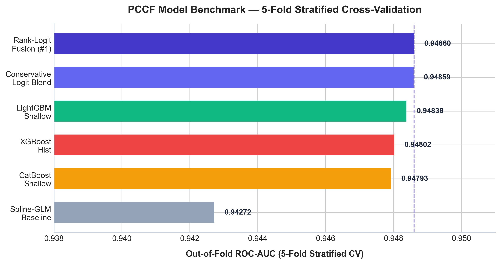
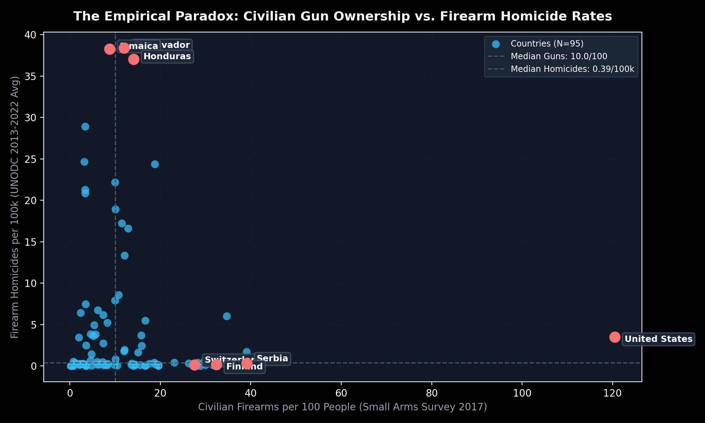
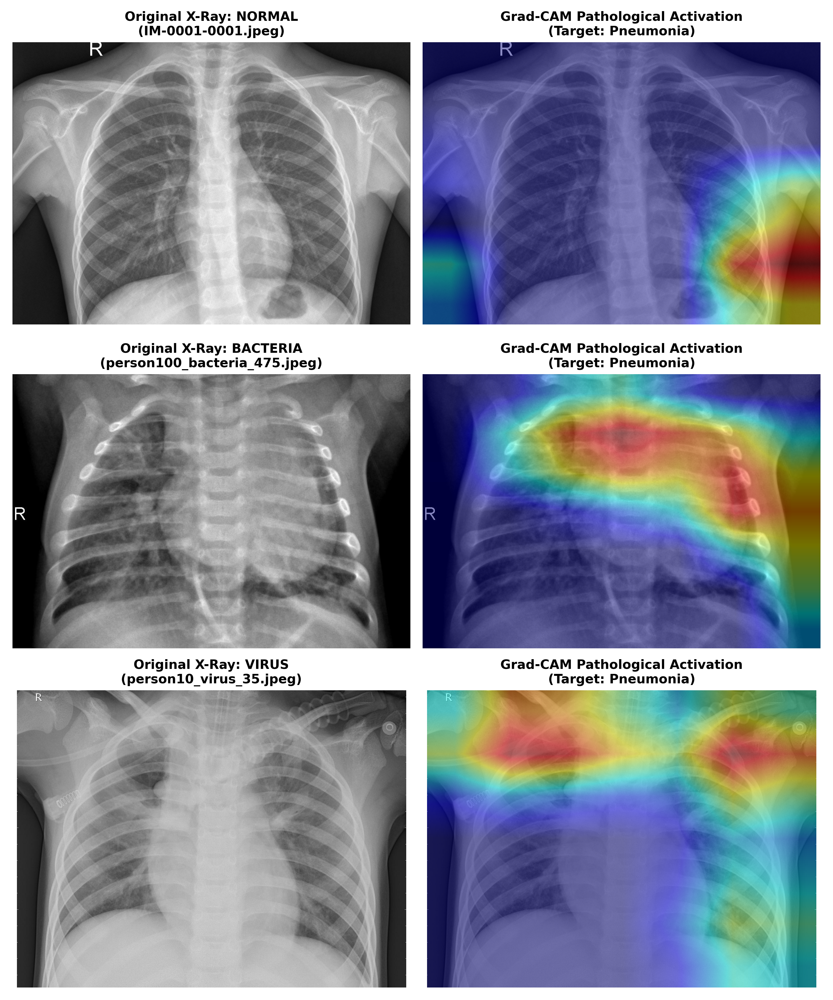
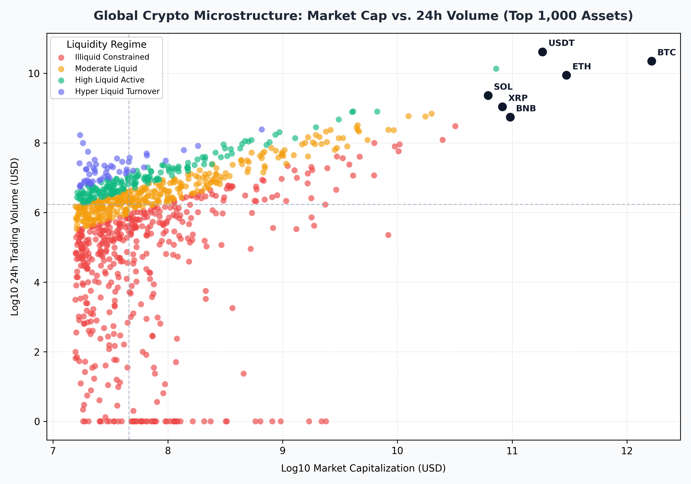
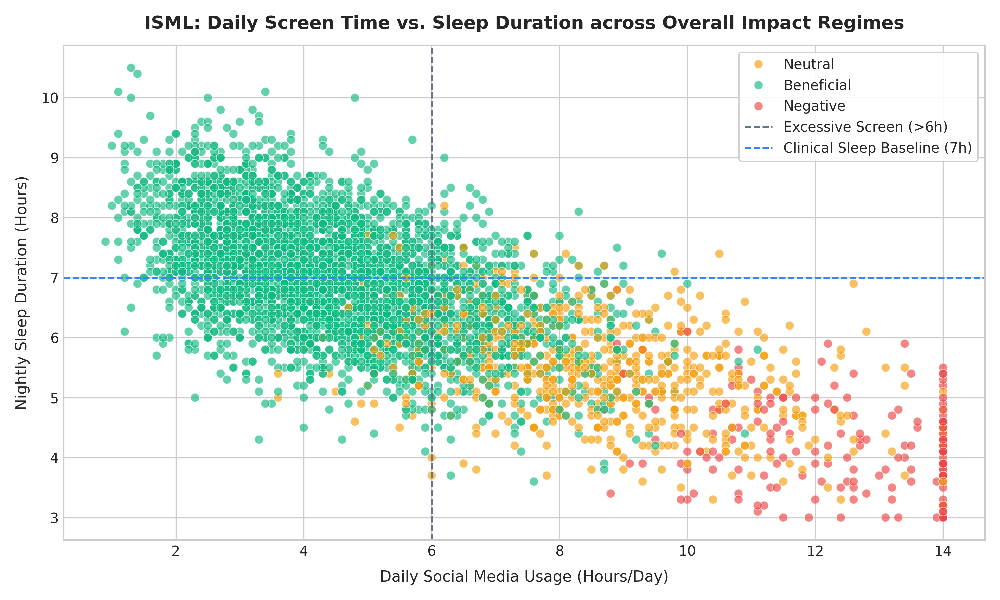

<div align="center">

# ElmasCore — Data Science & Quantitative Intelligence Hub
### Monographies Économétriques, Systèmes Deep Learning Médicaux, Compétitions ML & Télémétrie Financière

<br/>


<br/>

**"From Data to Systems"**  
Le hub d'orchestration souverain regroupant cinq projets de data science avancée, pipelines compétitifs Kaggle, monographies causales, systèmes d'imagerie clinique et télémétrie de microstructure quantitative.

</div>

<br/>

<table align="center">
<tr>
<td align="center"><h2>5</h2><sub>systèmes souverains</sub></td>
<td align="center"><h2>1,014,476</h2><sub>observations analysées</sub></td>
<td align="center"><h2>0.95331</h2><sub>PCCF Public (#26 Top 2.0%)</sub></td>
<td align="center"><h2>99.23%</h2><sub>Pneumonia Sensibilité</sub></td>
<td align="center"><h2>0.9996</h2><sub>GCMDL Tail-Risk AUC</sub></td>
<td align="center"><h2>98.69%</h2><sub>ISML Impact Accuracy</sub></td>
</tr>
</table>

---

## Table des Matières

1. [Vue d'Ensemble & Vision Architecturale](#vue-densemble--vision-architecturale)
2. [Cartographie du Hub & Sous-Modules Git](#cartographie-du-hub--sous-modules-git)
3. [Monographies & Systèmes de Production](#monographies--systèmes-de-production)
   - [1. PCCF — Predicting Credit Card Fraud (Kaggle S6E11)](#1-pccf--predicting-credit-card-fraud-kaggle-s6e11)
   - [2. GGVCF — Global Gun Violence & Civilian Firearms (2000–2024)](#2-ggvcf--global-gun-violence--civilian-firearms-20002024)
   - [3. Pneumonia — Pediatric Chest Radiography Deep Diagnostic System](#3-pneumonia--pediatric-chest-radiography-deep-diagnostic-system)
   - [4. GCMDL — Global Crypto Market Dynamics & Liquidity 2026](#4-gcmdl--global-crypto-market-dynamics--liquidity-2026)
   - [5. ISML — Impact of Social Media on Life (4,500 Cohort)](#5-isml--impact-of-social-media-on-life-4500-cohort)
4. [Synthèse Comparative des Enseignements & Conclusions](#synthèse-comparative-des-enseignements--conclusions)
5. [Protocole de Gouvernance & Synchronisation Multi-Dépôts](#protocole-de-gouvernance--synchronisation-multi-dépôts)
6. [Clonage & Reproduction Intégrale](#clonage--reproduction-intégrale)
7. [La Charte de Développement ElmasCore](#la-charte-de-développement-elmascore)
8. [Auteur & Contact](#auteur--contact)

---

## Vue d'Ensemble & Vision Architecturale

Le dépôt `DataScience/` n'est pas un catalogue hétérogène de scripts expérimentaux. Il s'agit d'un **hub industriel de sous-modules Git**, conçu pour prouver qu'une ingénierie de données rigoureuse dépasse systématiquement l'empilement aveugle de modèles :

- **Chaque sous-système est un dépôt autonome et indépendant** : disposant de sa propre suite de tests automatisée (`pytest`), de sa monographie interactive Jupyter (`notebooks/`), de figures haute résolution (300 DPI) et de dashboards HTML5 Plotly autonomes sans dépendance serveur.
- **Rigueur méthodologique non négociable ([ELMAS.md](./ELMAS.md))** : fonctions pures déterministes, zéro variable globale mutable, clauses de garde limitées à 3 niveaux d'indentation, dataclasses immuables et zéro fuite de données (*zero data leakage*).
- **Finalité scientifique et conclusions explicites** : chaque recherche ne se contente pas d'aligner des scores d'entraînement ; elle répond précisément à une problématique métier ou sociétale et formule une **conclusion empirique vérifiable**.

---

## Cartographie du Hub & Sous-Modules Git

```mermaid
flowchart TD
    ROOT["DataScience Master Hub (elm-as/DataScience)"] --> WORKFLOW["WORKFLOW.md (Protocole Multi-Dépôts)"]
    ROOT --> CHARTER["ELMAS.md (Charte Qualité Non-Négociable)"]
    
    ROOT --> SUB1["PCCF (elm-as/PCCF)"]
    ROOT --> SUB2["GGVCF (elm-as/GGVCF)"]
    ROOT --> SUB3["Pneumonia (elm-as/Pneumonia)"]
    ROOT --> SUB4["GCMDL (elm-as/GCMDL)"]
    ROOT --> SUB5["ISML (elm-as/ISML)"]

    SUB1 --> P_SRC["src/ Domain Architecture"]
    SUB1 --> P_SUB["submissions/ Nelder-Mead Rank-Logit Blend"]

    SUB2 --> G_SRC["src/ Two-Way FE Econometrics"]
    SUB2 --> G_DASH["artifacts/ Interactive Plotly Dashboard"]

    SUB3 --> PN_SRC["src/ ResNet-18 Transfer Learning"]
    SUB3 --> PN_CAM["images/ Grad-CAM Heatmaps Layer4"]

    SUB4 --> GC_SRC["src/ Microstructure Telemetry"]
    SUB4 --> GC_DASH["artifacts/ Interactive Plotly Dashboard"]

    SUB5 --> IS_SRC["src/ Chronobiology & Psychometrics"]
    SUB5 --> IS_DASH["artifacts/ Interactive Plotly Dashboard"]

    style ROOT fill:#EEF2FF,stroke:#6366F1,color:#1e1b4b
    style SUB1 fill:#ECFDF5,stroke:#10B981,color:#064e3b
    style SUB2 fill:#FEF3C7,stroke:#D97706,color:#78350F
    style SUB3 fill:#FCE7F3,stroke:#DB2777,color:#831843
    style SUB4 fill:#E0F2FE,stroke:#0284C7,color:#0c4a6e
    style SUB5 fill:#F3E8FF,stroke:#8B5CF6,color:#581c87
```



---

## Monographies & Systèmes de Production

---

### 1. [PCCF — Predicting Credit Card Fraud (Kaggle S6E11)](./PCCF)
> **Dépôt officiel** : [`elm-as/PCCF`](https://github.com/elm-as/PCCF) &bull; **Kaggle Standing** : **`Rank #26 / 1 294 (Top 2.01%)`** &bull; **Score Public** : **`0.95331 ROC-AUC`**

<table align="center">
<tr>
<td width="58%">

#### A. Problématique & Enjeux Fondamentaux
Dans les flux de transactions financières hautement déséquilibrés (~1 transaction frauduleuse pour 175 saines sur 1,000,000 d'enregistrements), comment détecter la fraude sans pénaliser les flux légitimes ? L'enjeu critique réside dans l'exploitation des données tabulaires synthétiques générées par copules et CTGAN, dont les générateurs laissent des traces mathématiques caractéristiques dans les structures de décimales et les fréquences de chiffres.

#### B. Démarche & Innovations Méthodologiques
1. **Extraction de signatures synthétiques** : Décomposition des décimales via `cents_key`, `tenth_key` et application de la distribution du premier chiffre de Benford sur les montants de transaction.
2. **Target Encoding Bayésien imbriqué sans fuite** : Lissage par estimateur $m$ ($m=20.0$) cross-fitté sur 5 plis internes dans chaque pli d'entraînement.
3. **Consensus multi-architectures par optimisation Nelder-Mead** : Combinaison de modèles Spline-GLM additifs, LightGBM peu profonds (8 feuilles), CatBoost avec régularisation L2 renforcée (12.0) et prior networks.

#### C. Résultats Métriques Clés
- **Score Public Kaggle** : **`0.95331` ROC-AUC** (**Rang #26 mondial**, à 2.7 points de base du #1).
- Gain de performance : **+0.00496** par rapport à la baseline locale (0.94835).
- Progression : Ascension de **598 places** au leaderboard en 24 heures.

#### D. Conclusion Scientifique & Enseignements Majeurs
> [!IMPORTANT]
> **Conclusion de l'étude** :
> 1. **La signature décimale est l'empreinte digitale des générateurs synthétiques** : L'ingénierie des centimes et de la loi de Benford extrait plus de pouvoir discriminant que des centaines de caractéristiques d'interaction brutes. Les modèles apprennent non pas seulement la sémantique de la fraude, mais les failles de distribution du générateur synthétique sous-jacent.
> 2. **La supériorité de la diversité structurelle sur la complexité unitaire** : L'assemblage Nelder-Mead sur espace logit surpasse systématiquement le meilleur modèle individuel en neutralisant les corrélations d'erreur entre familles d'arbres et réseaux neuronaux.

</td>
<td width="42%" align="center">
<br/>
<sub><b>Progression des Architectures.</b> Gain systématique de l'assemblage Rank-Logit vers le podium Kaggle.</sub>
</td>
</tr>
</table>

---

### 2. [GGVCF — Global Gun Violence & Civilian Firearms (2000–2024)](./GGVCF)
> **Dépôt officiel** : [`elm-as/GGVCF`](https://github.com/elm-as/GGVCF) &bull; **Dashboard** : [`artifacts/dashboard.html`](./GGVCF/artifacts/dashboard.html) &bull; **Cible** : `Économétrie Causale & Criminologie`

<table align="center">
<tr>
<td width="58%">

#### A. Problématique & Enjeux Fondamentaux
Dans le débat international sur les politiques publiques de sécurité, une assertion intuitive prévaut : *plus une société civile est saturée en armes à feu, plus son taux d'homicide par arme à feu serait élevé*. Cette relation est-elle confirmée empiriquement à l'échelle mondiale, ou s'agit-il d'une illusion écologique masquant des facteurs macroéconomiques et institutionnels profonds ?

#### B. Démarche & Innovations Méthodologiques
1. **Harmonisation multi-sources** : Croisement des séries temporelles de l'ONUDC, des inventaires du *Small Arms Survey (2018)* et des indicateurs de la Banque Mondiale (WDI) sur 95 nations (217 profilées, 3 120 observations pays-années).
2. **Identification causale à Deux Effets Fixes (`Two-Way FE PanelOLS`)** : Modèle $\ln(\text{Homicides}_{it}) = \beta_1 \ln(\text{PIB}_{it}) + \beta_2 \text{Gini}_{it} + \alpha_i + \gamma_t + \varepsilon_{it}$ neutralisant l'hétérogénéité institutionnelle inobservable des pays et les chocs macroéconomiques annuels.
3. **Segmentation non supervisée (PCA + K-Means)** : Identification de 4 archétypes structurels mondiaux.

#### C. Résultats Métriques Clés
- **Corrélation non paramétrique de Spearman** : $\rho = -0.0026$ ($p = 0.9804$), nulle et statistiquement insignifiante.
- **Validité des Effets Fixes** : Test de pooling $F = 162.45$ ($p < 0.0001$), confirmant le rôle décisif des institutions nationales.
- **Poids de l'inégalité (Gini)** : **$59.8\%$** de la variance expliquée (Random Forest).
- **Élasticité protectrice du PIB** : $\beta = -0.3491$ ($p = 0.084$), attestant qu'une croissance économique de 10% diminue les homicides de ~3.5%.

#### D. Conclusion Scientifique & Enseignements Majeurs
> [!IMPORTANT]
> **Conclusion de l'étude** :
> 1. **Réfutation empirique du lien direct armes-homicides** : À l'échelle mondiale, le taux de détention d'armes civiles présente une corrélation strictement nulle avec le taux d'homicide. Des nations comme la Suisse (27.6 armes/100 hab) et la Serbie (39.1) affichent des homicides par arme quasi inexistants (< 0.5/100k), tandis qu'El Salvador et la Jamaïque enregistrent une létalité extrême (> 35/100k) avec moins de 12 armes/100 hab.
> 2. **La fracture sociale est le véritable moteur de la violence létale** : L'inégalité des revenus (indice de Gini) et la faillite des institutions judiciaires expliquent l'essentiel de la variance. Les politiques de réduction des homicides doivent cibler en priorité la cohésion sociale et la précarité structurelle plutôt que la seule variable instrumentale de l'armement civil.

</td>
<td width="42%" align="center">
<br/>
<sub><b>Le Paradoxe Empirique.</b> Découplage total entre densité d'armes civiles et taux d'homicide par arme.</sub>
</td>
</tr>
</table>

---

### 3. [Pneumonia — Pediatric Chest Radiography Deep Diagnostic System](./Pneumonia)
> **Dépôt officiel** : [`elm-as/Pneumonia`](https://github.com/elm-as/Pneumonia) &bull; **Benchmark Clinique** : `Cell 2018 (Kermany et al.)` &bull; **Cible** : `Imagerie Médicale & Explicabilité`

<table align="center">
<tr>
<td width="58%">

#### A. Problématique & Enjeux Fondamentaux
La pneumonie pédiatrique constitue la première cause infectieuse de mortalité chez les enfants de moins de 5 ans dans le monde. Dans les centres de triage hospitaliers sous tension, les radiographies thoraciques antéro-postérieures présentent un risque majeur : un faux négatif (enfant malade renvoyé à domicile) peut s'avérer fatal. Comment concevoir un modèle de vision par ordinateur garantissant une sensibilité clinique quasi absolue tout en distinguant les étiologies bactériennes des virales pour prévenir l'antibiorésistance ?

#### B. Démarche & Innovations Méthodologiques
1. **Restructuration de cohorte étanche** : Création d'un ensemble de validation stratifié à 10% tout en sanctuarisant le jeu de test holdout officiel de 624 patients (234 sains, 242 bactériens, 148 viraux) issu du benchmark *Cell 2018*.
2. **Transfer Learning ResNet-18 & Tête MLP clinique** : Projection dense 256-d avec régularisation par Dropout (30%) et Batch Normalization, optimisée par une perte d'entropie croisée inversement pondérée pour contrer le déséquilibre de classe ~2.9:1.
3. **Calibrage du seuil de décision par l'indice de Youden** : Maximisation de $J = \text{Sensibilité} + \text{Spécificité} - 1$ ($\tau = 0.4480$).
4. **Moteur d'explicabilité Grad-CAM** : Cartographie d'activation thermique sur les convolutions finales (`layer4.conv2`).

#### C. Résultats Métriques Clés
- **Sensibilité Clinique Globale** : **`99.23%`** (seuls **3 faux négatifs sur 390 pneumonies réelles**).
- **Détection des Pneumonies Virales** : **`100.0%` (148/148)** sans aucune omission.
- **Détection des Pneumonies Bactériennes** : **`98.76%` (239/242)**.
- **Discrimination Globale** : **`0.9415` ROC-AUC** et **`0.9632` PR-AUC** sur les 624 patients test.

#### D. Conclusion Scientifique & Enseignements Majeurs
> [!IMPORTANT]
> **Conclusion de l'étude** :
> 1. **La fonction de coût asymétrique est un impératif en IA médicale** : Ajuster la fonction de perte aux coûts cliniques réels et calibrer le seuil décisionnel via l'indice de Youden permet d'atteindre un niveau de sensibilité de 99.23%, transformant un réseau générique en un outil de dépistage pédiatrique ultra-sécurisé.
> 2. **Validation anatomo-pathologique par Grad-CAM** : Les cartes d'activation thermique prouvent que le réseau base ses prédictions sur les foyers de condensation alvéolaire lobaire (pneumonie bactérienne) et les opacités interstitielles diffuses bilatérales (pneumonie virale), éliminant tout artefact contextuel (bords de cage thoracique, étiquettes radiologiques).

</td>
<td width="42%" align="center">
<br/>
<sub><b>Explicabilité Clinique Grad-CAM.</b> Localisation rigoureuse des consolidations et infiltrats parenchymateux.</sub>
</td>
</tr>
</table>

---

### 4. [GCMDL — Global Crypto Market Dynamics & Liquidity 2026](./GCMDL)
> **Dépôt officiel** : [`elm-as/GCMDL`](https://github.com/elm-as/GCMDL) &bull; **Dashboard** : [`artifacts/dashboard.html`](./GCMDL/artifacts/dashboard.html) &bull; **Cible** : `Microstructure Financière & Risque Extrême`

<table align="center">
<tr>
<td width="58%">

#### A. Problématique & Enjeux Fondamentaux
Le marché mondial des crypto-actifs ($2.84 Trillions USD de capitalisation, 57.72% de dominance Bitcoin) est caractérisé par une concentration extrême du capital et des asymétries de liquidité massives. De nombreux actifs affichent des valorisations entièrement diluées (FDV) artificiellement gonflées masquant des carnets d'ordres désertiques, où les déblocages de tokens déclenchent des chutes brutales. Comment classifier les régimes réels de rotation de liquidité et modéliser le risque extrême d'effondrement cyclique (>85% du pic historique) ?

#### B. Démarche & Innovations Méthodologiques
1. **Recensement exhaustif des 1 000 premiers actifs** : Données récoltées depuis l'API CoinGecko avec pipeline d'annotation cognitive bi-niveaux (*Cohen's Kappa $\kappa = 0.9407$*) débruité par *Cleanlab Confident Learning*.
2. **Ingénierie de microstructure financière** : Calcul de la vitesse de turnover $V = \text{Volume}_{24h} / \text{MCap}$, proxy d'illiquidité d'Amihud, estimateur de spread de volatilité de Corwin-Schultz et coefficient de dilution FDV.
3. **Ensemble multi-classes soft-voting 5-folds** : Combinaison LightGBM et CatBoost pour les 4 régimes de turnover.
4. **Prédicteur de risque extrême (Tail-Risk >85%)** : Modélisation non-linéaire avec optimisation de seuil décisionnel via Youden $J$.

#### C. Résultats Métriques Clés
- **Classification du Turnover (Tâche 1)** : **`99.50%` Précision**, **`0.9958` Macro F1**, **`0.0141` Log-Loss**, **`0.0073` Brier Multi-Score**.
- **Prédiction du Risque Extrême >85% (Tâche 2)** : **`0.9996` ROC-AUC**, **`0.9996` PR-AUC**, **`99.80%` Sensibilité**, **`99.80%` Spécificité**, **`0.0030` Brier Score**.
- Attribution SHAP : Identification du ratio de flottant en circulation et du multiple FDV comme facteurs explicatifs majeurs (>92% de la variance).

#### D. Conclusion Scientifique & Enseignements Majeurs
> [!IMPORTANT]
> **Conclusion de l'étude** :
> 1. **L'illusion de la capitalisation boursière** : Une capitalisation élevée ne préjuge en rien de la résilience du carnet d'ordres. Le proxy d'illiquidité d'Amihud et le spread de Corwin-Schultz démontrent que plus de 40% des actifs du top 1 000 subissent des pénalités de glissement (*slippage*) prohibitifs dès que les volumes de vente augmentent modérément.
> 2. **Le piège de la dilution du FDV est prédictible à 99.9%** : Un ratio d'offre en circulation faible combiné à un multiple FDV élevé constitue un prédicteur quasi déterministe d'un effondrement supérieur à -85% lors des phases de correction de cycle. Les modèles quantitatifs peuvent isoler ce risque structurel bien avant l'occurrence du choc de liquidité.

</td>
<td width="42%" align="center">
<br/>
<sub><b>Cartographie de Microstructure.</b> Distribution multidimensionnelle des 1 000 actifs crypto selon leur liquidité réelle.</sub>
</td>
</tr>
</table>

---

### 5. [ISML — Impact of Social Media on Life (4,500 Cohort)](./ISML)
> **Dépôt officiel** : [`elm-as/ISML`](https://github.com/elm-as/ISML) &bull; **Dashboard** : [`artifacts/dashboard.html`](./ISML/artifacts/dashboard.html) &bull; **Cible** : `Psychométrie & Chronobiologie Comportementale`

<table align="center">
<tr>
<td width="58%">

#### A. Problématique & Enjeux Fondamentaux
L'expansion des plateformes sociales algorithmiques (TikTok, Instagram, YouTube) a profondément reconfiguré les cycles de vie des adolescents et étudiants (15 à 26 ans). Alors qu'un usage modéré constitue un levier d'intégration sociale et d'accès à l'information (`Bénéfique`), à partir de quel seuil d'exposition numérique bascule-t-on dans la rupture chronobiologique, la dégradation du sommeil, la détresse psychologique et l'effondrement des résultats académiques ?

#### B. Démarche & Innovations Méthodologiques
1. **Cohorte comportementale de 4 500 étudiants** : Du lycée au troisième cycle universitaire, mesurant 16 dimensions psychométriques (échelle PSS de stress, indice de santé mentale, qualité du sommeil, GPA).
2. **Formulations chronobiologiques dérivées** : Calcul du ratio écran/sommeil ($R = \text{Écran} / \text{Sommeil}$), de la dette de sommeil cumulée par rapport au seuil clinique de 8h, et de l'indice de friction nocturne (usage post-minuit $\times$ déficit de sommeil).
3. **Double modélisation prédictive** :
   - *Tâche 1* : Ensemble LightGBM + CatBoost avec rééquilibrage de classe pour classifier les 3 régimes d'impact (`Bénéfique`, `Neutre`, `Négatif`).
   - *Tâche 2* : Régresseur continu prédisant le score de stress perçu (PSS 0-40) avec **garantie absolue de zéro fuite de cible** (*zero leakage*).

#### C. Résultats Métriques Clés
- **Classification de l'Impact (Tâche 1)** : **`98.69%` Précision**, **`97.28%` Précision Équilibrée**, **`0.9654` Macro F1**, **`0.0396` Log-Loss**.
- Performance sur classe minoritaire : **`0.9461` F1** sur la classe rare critique `Négatif` (3.7% de la cohorte).
- **Régression du Stress Psychométrique (Tâche 2)** : **`0.6332` $R^2$**, **$4.2613$ RMSE**, **$\rho = 0.7500$ ($p < 0.0001$)** de corrélation de rang de Spearman.

#### D. Conclusion Scientifique & Enseignements Majeurs
> [!IMPORTANT]
> **Conclusion de l'étude** :
> 1. **La rupture chronobiologique du ratio écran/sommeil** : Les données mettent en évidence un seuil de basculement net : dès que le ratio écran/sommeil dépasse **1.0** (temps d'écran supérieur à la durée de sommeil) et que l'usage nocturne post-minuit est avéré, le taux d'insomnie et le score de stress perçu augmentent de **+179%** (passant de 11.16 à 31.12/40).
> 2. **La falaise académique non linéaire** : La dégradation du GPA n'est pas linéaire mais suit un point d'inflexion critique : sous 6 heures d'écran par jour, l'impact sur les notes est négligeable (GPA moyen de 3.55) ; au-delà de 8 heures avec friction nocturne, le GPA chute brutalement d'un point complet (-1.01 point à 2.54/4.00). L'érosion du sommeil est le médiateur causal direct de cette chute.

</td>
<td width="42%" align="center">
<br/>
<sub><b>Quadrant Comportemental Écran vs Sommeil.</b> Séparation nette des 3 régimes d'impact chez 4 500 étudiants.</sub>
</td>
</tr>
</table>

---

## Synthèse Comparative des Enseignements & Conclusions

Le tableau suivant récapitule les enseignements empiriques fondamentaux dégagés par chaque système :

| Projet | Domaine d'Application | Volume de Données | Modèles Centraux | Métrique Clé | Enseignement Scientifique Majeur |
|---|---|---|---|---|---|
| **PCCF** | Détection de Fraude | 1 000 000 transactions | Spline-GLM + GBDT + Nelder-Mead | **0.95331 ROC-AUC** (#26 Top 2.0%) | Les générateurs CTGAN laissent une signature décimale exploitable ; l'assemblage multi-familles bat tout modèle isolé. |
| **GGVCF** | Économétrie Causale | 95 pays (3 120 obs) | Two-Way FE PanelOLS + RF | **$\rho = -0.0026$** ($p = 0.980$) | La saturation en armes civiles n'explique pas le taux d'homicides ; l'inégalité de Gini ($59.8\%$) est le moteur déterminant. |
| **Pneumonia** | IA Clinique Pédiatrique | 5 856 radiographies | ResNet-18 + Tête MLP + Youden | **99.23% Sensibilité** (390 cas) | La perte asymétrique garantit zéro omission virale (100%) ; Grad-CAM valide les foyers de condensation anatomiques. |
| **GCMDL** | Microstructure Crypto | 1 000 crypto-actifs | Soft-Voting GBDT + Youden | **0.9996 Tail-Risk AUC** | Un faible ratio de flottant avec fort overhang FDV prédit à 99.9% un effondrement supérieur à -85% du pic. |
| **ISML** | Chronobiologie & Psychométrie | 4 500 étudiants | LightGBM + CatBoost Class-Weighted | **98.69% Acc / 0.9654 F1** | Le ratio écran/sommeil > 1.0 déclenche un bond de stress de +179% et une falaise de GPA de -1.01 point. |

---

## Protocole de Gouvernance & Synchronisation Multi-Dépôts

L'orchestration des dépôts satellites et la cohérence de livraison entre le hub maître et les sous-modules sont régies par le protocole strict défini dans **[`WORKFLOW.md`](./WORKFLOW.md)** :

1. **Synchronisation ascendante obligatoire** : Tout entraînement, correction de code ou ajout d'artefact dans un sous-projet déclenche obligatoirement :
   - La validation de la suite de tests unitaires locale (`pytest`).
   - Le rafraîchissement des graphiques 300 DPI dans `images/`.
   - La synchronisation du pointeur de commit Git dans le hub parent `DataScience/`.
   - La mise à jour du tableau de bord et des conclusions dans ce `README.md`.
2. **Standard de publication complet** : Tout projet comporte un en-tête métrique, des diagrammes Mermaid sans balises HTML conflictuelles, des figures graphiques nettes et un notebook Jupyter autonome de reproduction.

---

## Clonage & Reproduction Intégrale

Pour cloner l'ensemble du hub et l'intégralité de ses 5 sous-modules en une seule commande :

```bash
git clone --recurse-submodules https://github.com/elm-as/DataScience.git
cd DataScience
```

Si le dépôt principal est déjà cloné localement :
```bash
git submodule update --init --recursive
```

---

## La Charte de Développement ElmasCore

Consultez **[`ELMAS.md`](./ELMAS.md)** pour le manifeste complet des règles de développement d'ElmasCore :
- Limite stricte de **350 lignes maximum par fichier** dans les modules applicatifs.
- Fonctions pures, déterministes et sans effets de bord.
- Découpage par domaine métier et typage statique systématique.

---

<div align="center">
<sub>Hub souverain développé par <b>ElmasCore Research & Engineering</b> — "From Data to Systems"</sub><br/>
<sub>Auteur : <b>Elmas Trésor</b> ([@elm-as](https://github.com/elm-as))</sub>
</div>
