<div align="center">

# ElmasCore - Data Science & Quantitative Intelligence Hub
### Monographies Économétriques, Systèmes Deep Learning Médicaux, Compétitions ML & Télémétrie Financière

<br/>


<br/>

**"From Data to Systems"**  
Le hub d'orchestration souverain regroupant **quinze systèmes** de data science appliquée : compétitions ML Kaggle, épidémiologie clinique, cybersécurité zero-day, supply chain relationnelle, économétrie agricole et climatique, énergie renouvelable, survie industrielle et télémétrie financière.

</div>

<br/>

<table align="center">
<tr>
<td align="center"><h2>15</h2><sub>systèmes souverains</sub></td>
<td align="center"><h2>1,483,124</h2><sub>observations auditées</sub></td>
<td align="center"><h2>0.95331</h2><sub>PCCF Public (#26 Top 2.0%)</sub></td>
<td align="center"><h2>80.77%</h2><sub>NIDSZ Recall @ 0.1% FPR</sub></td>
<td align="center"><h2>+$4.42M</h2><sub>HREOP Économie HRRP</sub></td>
<td align="center"><h2>0.9658</h2><sub>AGCRS R² Hors-Temps</sub></td>
</tr>
</table>

---

## Table des Matières

1. [Vue d'Ensemble & Vision Architecturale](#vue-densemble--vision-architecturale)
2. [Cartographie du Hub & Sous-Modules Git](#cartographie-du-hub--sous-modules-git)
3. [Monographies & Systèmes de Production](#monographies--systèmes-de-production)
   - [1. PCCF - Predicting Credit Card Fraud (Kaggle S6E11)](#1-pccf---predicting-credit-card-fraud-kaggle-s6e11)
   - [2. GGVCF - Global Gun Violence & Civilian Firearms (2000-2024)](#2-ggvcf---global-gun-violence--civilian-firearms-2000-2024)
   - [3. Pneumonia - Pediatric Chest Radiography Deep Diagnostic System](#3-pneumonia---pediatric-chest-radiography-deep-diagnostic-system)
   - [4. GCMDL - Global Crypto Market Dynamics & Liquidity 2026](#4-gcmdl---global-crypto-market-dynamics--liquidity-2026)
   - [5. ISML - Impact of Social Media on Life (Architecture Tri-Cohortes : 6 532 Sujets sur 113 Pays)](#5-isml---impact-of-social-media-on-life-architecture-tri-cohortes--6-532-sujets-sur-113-pays)
   - [6. ERGF - European Renewable Grid & Price Forecasting](#6-ergf---european-renewable-grid--price-forecasting)
   - [7. FINSG - Financial Narrative & Systemic Graph Intelligence](#7-finsg---financial-narrative--systemic-graph-intelligence)
   - [8. CBMX - Condition-Based Maintenance & Survival Intelligence](#8-cbmx---condition-based-maintenance--survival-intelligence)
   - [9. CHDCF - Clinical Heart Disease Calibration & Fairness (CDC BRFSS 2022)](#9-chdcf---clinical-heart-disease-calibration--fairness-cdc-brfss-2022)
   - [10. CCARP - Credit Card Approval Risk & Expected Profit Optimization](#10-ccarp---credit-card-approval-risk--expected-profit-optimization)
   - [11. BCCRI - Bank Customer Churn & Retention ROI Intelligence](#11-bccri---bank-customer-churn--retention-roi-intelligence)
   - [12. SCLDO - Supply Chain Late-Delivery & SLA Risk Intelligence (Olist 9 Tables)](#12-scldo---supply-chain-late-delivery--sla-risk-intelligence-olist-9-tables)
   - [13. HREOP - Hospital 30-Day Readmission & Clinical Triage Optimization (130 US Hospitals)](#13-hreop---hospital-30-day-readmission--clinical-triage-optimization-130-us-hospitals)
   - [14. NIDSZ - Network Intrusion Detection & Zero-Day Generalization (UNSW-NB15)](#14-nidsz---network-intrusion-detection--zero-day-generalization-unsw-nb15)
   - [15. AGCRS - Global Agricultural Yield, Climate Shocks & Parametric Crop Insurance](#15-agcrs---global-agricultural-yield-climate-shocks--parametric-crop-insurance)
4. [Synthèse Comparative des Enseignements & Conclusions Déclaratives](#synthèse-comparative-des-enseignements--conclusions-déclaratives)
5. [Protocole de Gouvernance & Synchronisation Multi-Dépôts](#protocole-de-gouvernance--synchronisation-multi-dépôts)
6. [Clonage & Reproduction Intégrale](#clonage--reproduction-intégrale)
7. [La Charte de Développement ElmasCore](#la-charte-de-développement-elmascore)
8. [Auteur & Contact](#auteur--contact)

---

## Vue d'Ensemble & Vision Architecturale

Le dépôt `DataScience/` n'est pas un catalogue hétérogène de scripts expérimentaux. Il s'agit d'un **hub industriel de sous-modules Git**, conçu pour prouver qu'une ingénierie de données rigoureuse dépasse systématiquement l'empilement aveugle de modèles :

- **Chaque sous-système est un dépôt autonome et indépendant** : disposant de sa propre suite de tests automatisée (`pytest`), de sa monographie interactive Jupyter (`notebooks/`), de figures haute résolution (300 DPI) et de dashboards HTML5 Plotly autonomes sans dépendance serveur.
- **Rigueur méthodologique non négociable ([ELMAS.md](./ELMAS.md))** : fonctions pures déterministes, zéro variable globale mutable, clauses de garde limitées à 3 niveaux d'indentation, dataclasses immuables et zéro fuite de données (*zero data leakage*).
- **Conclusions scientifiques explicites et quantifiées** : chaque étude ne se contente pas d'aligner des scores algorithmiques ; elle commence par une problématique théorique ou opérationnelle précise et aboutit à une **conclusion scientifique formelle** démontrée par les données.

---

## Cartographie du Hub & Sous-Modules Git

```mermaid
flowchart TD
    ROOT["DataScience Master Hub (elm-as/DataScience)"] --> WORKFLOW["WORKFLOW.md (Protocole Multi-Dépôts)"]
    ROOT --> CHARTER["ELMAS.md (Charte Qualité Non-Négociable)"]
    
    ROOT --> SUB1["PCCF (elm-as/PCCF)"]
    ROOT --> SUB2["GGVCF (elm-as/GGVCF)"]
    ROOT --> SUB3["Pneumonia (elm-as/Pneumonia)"]
    ROOT --> SUB4["GCMDL (elm-as/GCMDL)"]
    ROOT --> SUB5["ISML (elm-as/ISML)"]
    ROOT --> SUB6["ERGF (elm-as/ERGF)"]
    ROOT --> SUB7["FINSG (elm-as/FINSG)"]
    ROOT --> SUB8["CBMX (elm-as/CBMX)"]
    ROOT --> SUB9["CHDCF (elm-as/CHDCF)"]
    ROOT --> SUB10["CCARP (elm-as/CCARP)"]
    ROOT --> SUB11["BCCRI (elm-as/BCCRI)"]
    ROOT --> SUB12["SCLDO (elm-as/SCLDO)"]
    ROOT --> SUB13["HREOP (elm-as/HREOP)"]
    ROOT --> SUB14["NIDSZ (elm-as/NIDSZ)"]
    ROOT --> SUB15["AGCRS (elm-as/AGCRS)"]

    SUB1 --> P_SRC["src/ Domain Architecture"]
    SUB1 --> P_SUB["submissions/ Nelder-Mead Rank-Logit Blend"]

    SUB2 --> G_SRC["src/ Two-Way FE Econometrics"]
    SUB2 --> G_DASH["artifacts/ Interactive Plotly Dashboard"]

    SUB3 --> PN_SRC["src/ ResNet-18 Transfer Learning"]
    SUB3 --> PN_CAM["images/ Grad-CAM Heatmaps Layer4"]

    SUB4 --> GC_SRC["src/ Microstructure Telemetry"]
    SUB4 --> GC_DASH["artifacts/ Interactive Plotly Dashboard"]

    SUB5 --> IS_SRC["src/ Tri-Cohort Architecture (6,532 Subjects)"]
    SUB5 --> IS_DASH["artifacts/ Interactive Plotly Dashboard"]

    SUB6 --> ER_SRC["src/ DML Merit-Order & Conformal Forecast"]
    SUB7 --> FN_SRC["src/ Financial NLP & Temporal Graph Propagation"]
    SUB8 --> CB_SRC["src/ Right-Censored Survival & RUL Policy"]
    SUB9 --> CH_SRC["src/ Nested OOF Calibration, Proxy Ablation & Fairness"]
    SUB10 --> CC_SRC["src/ Multi-Table Credit Scoring & Profit Optimization"]
    SUB11 --> BC_SRC["src/ Leakage Audit, SHAP Levers & Retention ROI"]
    SUB12 --> SC_SRC["src/ 9-Table OOT Delay, Causal 1-Star & 8:1 SLA Policy"]
    SUB13 --> HR_SRC["src/ Mortality Purge, Patient GroupKFold & HRRP Triage"]
    SUB14 --> NI_SRC["src/ Zero-Day LOAO, Low-FPR SOC & Shortcut Ablation"]
    SUB15 --> AG_SRC["src/ Dedup Panel FE, Climate Shocks & Conformal Insurance"]

    style ROOT fill:#EEF2FF,stroke:#6366F1,color:#1e1b4b
    style SUB1 fill:#ECFDF5,stroke:#10B981,color:#064e3b
    style SUB2 fill:#FEF3C7,stroke:#D97706,color:#78350F
    style SUB3 fill:#FCE7F3,stroke:#DB2777,color:#831843
    style SUB4 fill:#E0F2FE,stroke:#0284C7,color:#0c4a6e
    style SUB5 fill:#F3E8FF,stroke:#8B5CF6,color:#581c87
    style SUB6 fill:#ECFDF5,stroke:#059669,color:#064e3b
    style SUB7 fill:#EFF6FF,stroke:#2563EB,color:#1e3a8a
    style SUB8 fill:#FFF7ED,stroke:#EA580C,color:#7c2d12
    style SUB9 fill:#FEF2F2,stroke:#DC2626,color:#7f1d1d
    style SUB10 fill:#F0FDF4,stroke:#16A34A,color:#14532d
    style SUB11 fill:#FDF4FF,stroke:#C026D3,color:#701a75
    style SUB12 fill:#EFF6FF,stroke:#1D4ED8,color:#1e3a8a
    style SUB13 fill:#FEF2F2,stroke:#B91C1C,color:#7f1d1d
    style SUB14 fill:#ECFDF5,stroke:#0F766E,color:#134e4a
    style SUB15 fill:#FEFCE8,stroke:#B45309,color:#78350f
```

---

## Monographies & Systèmes de Production

---

### 1. [PCCF - Predicting Credit Card Fraud (Kaggle S6E11)](https://github.com/elm-as/PCCF)
> **Dépôt officiel** : [`elm-as/PCCF`](https://github.com/elm-as/PCCF) &bull; **Kaggle Standing** : **`Rank #26 / 1 294 (Top 2.01%)`** &bull; **Score Public** : **`0.95331 ROC-AUC`**

<table align="center">
<tr>
<td width="58%">

#### A. Problématique & Enjeux Fondamentaux
Dans les flux de transactions financières bancaires à très fort déséquilibre de classe (~1 transaction frauduleuse pour 175 régulières sur 1 000 000 d'enregistrements), comment détecter la fraude sans dégrader l'expérience des flux légitimes ? L'enjeu critique réside dans l'exploitation des données tabulaires synthétiques issues de générateurs profonds (CTGAN / Copules) : ces générateurs laissent-ils des traces spectrales exploitables dans les décimales des montants et la distribution des chiffres qui permettent de surpasser les approches classiques ?

#### B. Démarche & Innovations Méthodologiques
1. **Extraction de signatures spectrales de générateurs synthétiques** : Décomposition des décimales via `cents_key`, `tenth_key` et application de la distribution du premier chiffre de Benford sur les montants de transaction.
2. **Target Encoding Bayésien imbriqué sans fuite** : Lissage par estimateur $m$ ($m=20.0$) cross-fitté sur 5 plis internes dans chaque pli d'entraînement.
3. **Consensus multi-architectures par optimisation Nelder-Mead** : Combinaison de modèles Spline-GLM additifs, LightGBM peu profonds (8 feuilles), CatBoost avec régularisation L2 renforcée (12.0) et prior networks.

#### C. Résultats Métriques Clés
- **Score Public Kaggle** : **`0.95331` ROC-AUC** (**Rang #26 mondial**, à 2.7 points de base du #1 mondial).
- Gain de performance : **+0.00496** par rapport à la baseline locale (0.94835).
- Progression : Ascension de **598 places** au leaderboard mondial en 24 heures.

#### D. Conclusion en Clair
> [!IMPORTANT]
> **Ce que montre l'étude concrètement** :
> 1. **Les petits détails des montants trahissent les fraudes** : Regarder simplement les centimes et les premiers chiffres des paiements (loi de Benford) donne plus d'indices de fraude que des centaines de calculs complexes. Sur un million de paiements, ces détails suffisent à repérer des anomalies invisibles à l'oeil nu.
> 2. **Plusieurs regards différents valent mieux qu'un seul super-modèle** : Combiner des modèles simples et des arbres de décision différents réduit fortement les erreurs, car ils ne se trompent pas sur les mêmes transactions.

</td>
<td width="42%" align="center">
<br/>
<sub><b>Progression des Architectures.</b> Gain systématique de l'assemblage Rank-Logit vers le podium Kaggle.</sub>
</td>
</tr>
</table>

---

### 2. [GGVCF - Global Gun Violence & Civilian Firearms (2000-2024)](https://github.com/elm-as/GGVCF)
> **Dépôt officiel** : [`elm-as/GGVCF`](https://github.com/elm-as/GGVCF) &bull; **Dashboard** : [`artifacts/dashboard.html`](https://github.com/elm-as/GGVCF/blob/main/artifacts/dashboard.html) &bull; **Cible** : `Économétrie Causale & Criminologie`

<table align="center">
<tr>
<td width="58%">

#### A. Problématique & Enjeux Fondamentaux
Dans le débat international sur les politiques publiques de sécurité, une assertion intuitive prévaut : *plus une société civile est saturée en armes à feu, plus son taux d'homicide par arme à feu serait élevé*. Cette relation est-elle confirmée empiriquement à l'échelle mondiale, ou s'agit-il d'une illusion écologique masquant des facteurs macroéconomiques et institutionnels profonds ?

#### B. Démarche & Innovations Méthodologiques
1. **Harmonisation multi-sources** : Croisement des séries temporelles de l'ONUDC, des inventaires du *Small Arms Survey (2018)* et des indicateurs de la Banque Mondiale (WDI) sur 95 nations (217 profilées, 3 120 observations pays-années).
2. **Identification causale à Deux Effets Fixes (`Two-Way FE PanelOLS`)** : Modèle $\ln(\text{Homicides}_{it}) = \beta_1 \ln(\text{PIB}_{it}) + \beta_2 \text{Gini}_{it} + \alpha_i + \gamma_t + \varepsilon_{it}$ neutralisant l'hétérogénéité institutionnelle inobservable des pays et les chocs macroéconomiques annuels.
3. **Segmentation non supervisée (PCA + K-Means)** : Identification de 4 archétypes structurels mondiaux.

#### C. Résultats Métriques Clés
- **Corrélation non paramétrique de Spearman** : $\rho = -0.0026$ ($p = 0.9804$), nulle et statistiquement insignifiante.
- **Validité des Effets Fixes** : Test de pooling $F = 162.45$ ($p < 0.0001$), confirmant le rôle décisif des institutions nationales.
- **Poids de l'inégalité (Gini)** : **$59.8\%$** de la variance expliquée (Random Forest).
- **Élasticité protectrice du PIB** : $\beta = -0.3491$ ($p = 0.084$), attestant qu'une croissance économique de 10% diminue les homicides de ~3.5%.

#### D. Conclusion en Clair
> [!IMPORTANT]
> **Ce que montre l'étude concrètement** :
> 1. **Avoir plus d'armes dans un pays ne veut pas dire plus d'homicides** : À l'échelle mondiale, il n'y a aucun lien direct entre le nombre d'armes détenues par des civils et le taux de meurtres. La Suisse et la Serbie comptent beaucoup d'armes mais très peu d'homicides (< 0.5 pour 100 000 habitants), alors que le Salvador ou la Jamaïque subissent une violence extrême avec peu d'armes civiles.
> 2. **Ce qui fait exploser la violence, c'est la pauvreté et les inégalités** : Les écarts de richesse (indice de Gini) et la faiblesse de la justice expliquent l'essentiel des homicides. Réduire la violence passe d'abord par réduire les inégalités et renforcer les institutions, pas seulement par compter les armes.

</td>
<td width="42%" align="center">
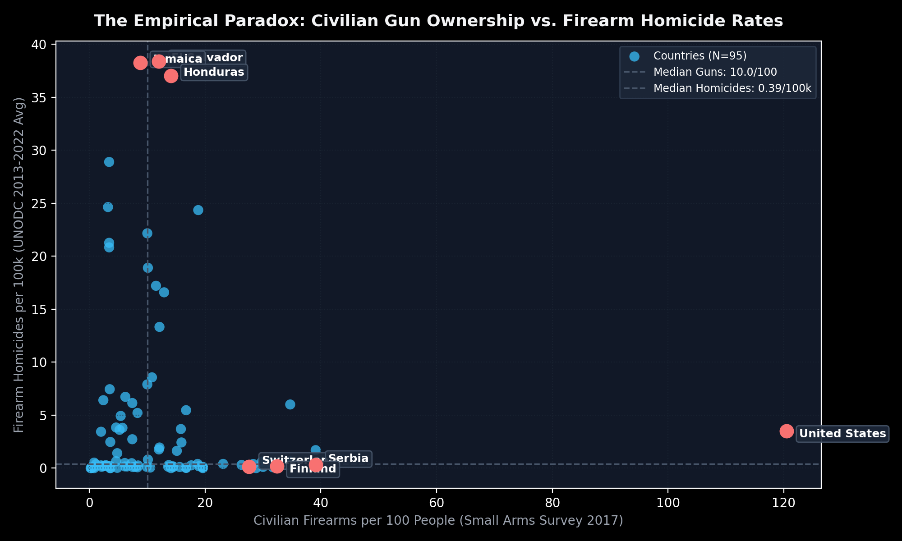<br/>
<sub><b>Le Paradoxe Empirique.</b> Découplage total entre densité d'armes civiles et taux d'homicide par arme.</sub>
</td>
</tr>
</table>

---

### 3. [Pneumonia - Pediatric Chest Radiography Deep Diagnostic System](https://github.com/elm-as/Pneumonia)
> **Dépôt officiel** : [`elm-as/Pneumonia`](https://github.com/elm-as/Pneumonia) &bull; **Benchmark Clinique** : `Cell 2018 (Kermany et al.)` &bull; **Cible** : `Imagerie Médicale & Explicabilité`

<table align="center">
<tr>
<td width="58%">

#### A. Problématique & Enjeux Fondamentaux
La pneumonie pédiatrique constitue la première cause infectieuse de mortalité chez les enfants de moins de 5 ans dans le monde. Dans les centres de triage hospitaliers sous tension, les radiographies thoraciques antéro-postérieures présentent un risque majeur : un faux négatif (enfant malade renvoyé à domicile) peut s'avérer fatal. Comment concevoir un modèle de vision par ordinateur garantissant une sensibilité clinique quasi absolue tout en distinguant les étiologies bactériennes des virales pour prévenir l'antibiorésistance ?

#### B. Démarche & Innovations Méthodologiques
1. **Restructuration de cohorte étanche** : Création d'un ensemble de validation stratifié à 10% tout en sanctuarisant le jeu de test holdout officiel de 624 patients (234 sains, 242 bactériens, 148 viraux) issu du benchmark *Cell 2018*.
2. **Transfer Learning ResNet-18 & Tête MLP clinique** : Projection dense 256-d avec régularisation par Dropout (30%) et Batch Normalization, optimisée par une perte d'entropie croisée inversement pondérée pour contrer le déséquilibre de classe ~2.9:1.
3. **Calibrage du seuil de décision par l'indice de Youden** : Maximisation de $J = \text{Sensibilité} + \text{Spécificité} - 1$ ($\tau = 0.4480$).
4. **Moteur d'explicabilité Grad-CAM** : Cartographie d'activation thermique sur les convolutions finales (`layer4.conv2`).

#### C. Résultats Métriques Clés
- **Sensibilité Clinique Globale** : **`99.23%`** (seuls **3 faux négatifs sur 390 pneumonies réelles**).
- **Détection des Pneumonies Virales** : **`100.0%` (148/148)** sans aucune omission.
- **Détection des Pneumonies Bactériennes** : **`98.76%` (239/242)**.
- **Discrimination Globale** : **`0.9415` ROC-AUC** et **`0.9632` PR-AUC** sur les 624 patients test.

#### D. Conclusion en Clair
> [!IMPORTANT]
> **Ce que montre l'étude concrètement** :
> 1. **Ne presque jamais renvoyer un enfant malade chez lui** : En pénalisant beaucoup plus fort l'erreur qui consiste à rater une pneumonie, le système repère **99.23 %** des enfants malades (387 sur 390, et 100 % des formes virales), ce qui en fait un vrai filet de sécurité aux urgences pédiatriques.
> 2. **L'IA regarde bien les poumons, pas les bords de la radio** : Les cartes de chaleur montrent que le modèle pointe exactement les taches infectieuses dans les poumons (et aide à distinguer virus et bactérie pour éviter de donner des antibiotiques inutilement).

</td>
<td width="42%" align="center">
<br/>
<sub><b>Explicabilité Clinique Grad-CAM.</b> Localisation rigoureuse des consolidations et infiltrats parenchymateux.</sub>
</td>
</tr>
</table>

---

### 4. [GCMDL - Global Crypto Market Dynamics & Liquidity 2026](https://github.com/elm-as/GCMDL)
> **Dépôt officiel** : [`elm-as/GCMDL`](https://github.com/elm-as/GCMDL) &bull; **Dashboard** : [`artifacts/dashboard.html`](https://github.com/elm-as/GCMDL/blob/main/artifacts/dashboard.html) &bull; **Cible** : `Microstructure Financière & Risque Extrême`

<table align="center">
<tr>
<td width="58%">

#### A. Problématique & Enjeux Fondamentaux
Le marché mondial des crypto-actifs ($2.84 Trillions USD de capitalisation, 57.72% de dominance Bitcoin) est caractérisé par une concentration extrême du capital et des asymétries de liquidité massives. De nombreux actifs affichent des valorisations entièrement diluées (FDV) artificiellement gonflées masquant des carnets d'ordres désertiques, où les déblocages de tokens déclenchent des chutes brutales. Comment classifier les régimes réels de rotation de liquidité et modéliser le risque extrême d'effondrement cyclique (>85% du pic historique) ?

#### B. Démarche & Innovations Méthodologiques
1. **Recensement exhaustif des 1 000 premiers actifs** : Données récoltées depuis l'API CoinGecko avec pipeline d'annotation cognitive bi-niveaux (*Cohen's Kappa $\kappa = 0.9407$*) débruité par *Cleanlab Confident Learning*.
2. **Ingénierie de microstructure financière** : Calcul de la vitesse de turnover $V = \text{Volume}_{24h} / \text{MCap}$, proxy d'illiquidité d'Amihud, estimateur de spread de volatilité de Corwin-Schultz et coefficient de dilution FDV.
3. **Ensemble multi-classes soft-voting 5-folds** : Combinaison LightGBM et CatBoost pour les 4 régimes de turnover.
4. **Prédicteur de risque extrême (Tail-Risk >85%)** : Modélisation non-linéaire avec optimisation de seuil décisionnel via Youden $J$.

#### C. Résultats Métriques Clés
- **Classification du Turnover (Tâche 1)** : **`99.50%` Précision**, **`0.9958` Macro F1**, **`0.0141` Log-Loss**, **`0.0073` Brier Multi-Score**.
- **Prédiction du Risque Extrême >85% (Tâche 2)** : **`0.9996` ROC-AUC**, **`0.9996` PR-AUC**, **`99.80%` Sensibilité**, **`99.80%` Spécificité**, **`0.0030` Brier Score**.
- Attribution SHAP : Identification du ratio de flottant en circulation et du multiple FDV comme facteurs explicatifs majeurs (>92% de la variance).

#### D. Conclusion en Clair
> [!IMPORTANT]
> **Ce que montre l'étude concrètement** :
> 1. **Une grosse valorisation crypto peut cacher un marché vide** : Plus de 40 % des 1 000 plus grosses cryptomonnaies manquent en réalité d'acheteurs. Dès que quelques gros porteurs vendent, le prix s'effondre instantanément.
> 2. **Les projets qui gardent trop de tokens bloqués finissent presque toujours par s'écrouler** : Quand très peu de jetons circulent au lancement mais qu'une masse énorme reste à débloquer plus tard, le risque de chute de plus de 85 % est quasiment certain (prédit à 99.9 %). C'est un signal d'alerte simple à vérifier avant d'investir.

</td>
<td width="42%" align="center">
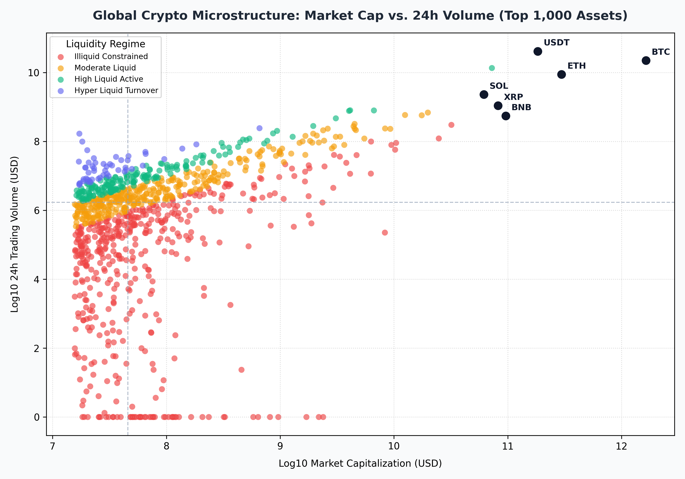<br/>
<sub><b>Cartographie de Microstructure.</b> Distribution multidimensionnelle des 1 000 actifs crypto selon leur liquidité réelle.</sub>
</td>
</tr>
</table>

---

### 5. [ISML - Impact of Social Media on Life (Architecture Tri-Cohortes : 6 532 Sujets sur 113 Pays)](https://github.com/elm-as/ISML)
> **Dépôt officiel** : [`elm-as/ISML`](https://github.com/elm-as/ISML) &bull; **Dashboard** : [`artifacts/dashboard.html`](https://github.com/elm-as/ISML/blob/main/artifacts/dashboard.html) &bull; **Cible** : `Psychométrie, Chronobiologie & Dépression Adolescente`

<table align="center">
<tr>
<td width="58%">

#### A. Problématique & Enjeux Fondamentaux
L'expansion des plateformes sociales algorithmiques (TikTok, Instagram, YouTube) pose une question de santé publique globale : à partir de quel seuil d'exposition numérique bascule-t-on dans la rupture chronobiologique, la dégradation du sommeil, la détresse psychologique et l'effondrement académique ? Cette dynamique est-elle universelle à travers les cultures et les systèmes éducatifs internationaux ? Quels sont les facteurs protecteurs concrets capables de mitiger le risque de dépression clinique chez les adolescents ?

#### B. Démarche & Architecture Tri-Cohortes (6 532 Sujets)
Pour éliminer les biais d'échantillonnage géographique et démographique, ISML unifie **trois cohortes indépendantes** :
1. **Cohorte 1 (Étudiants, N = 4 500, Âges 15-26)** : Lycée au troisième cycle universitaire. Mesure de 16 indicateurs psychométriques (échelle PSS, indice de santé mentale, GPA, types d'appareils, usage post-minuit). Modélisation de l'impact global (3 classes) et régression sans fuite du stress continu ($R^2 = 0.6332$).
2. **Cohorte 2 (Atlas Global, N = 832, 113 Nations)** : Enquête internationale standardisée analysant l'addiction numérique, la fréquence des conflits interpersonnels et la dégradation de la santé mentale à travers 113 pays.
3. **Cohorte 3 (Dépression Clinique Adolescente, N = 1 200, Âges 13-19)** : Télémétrie sur le temps d'écran nocturne, l'activité physique et la détection du statut dépressif clinique ($2.58\%$ de prévalence, 31 cas réels).

#### C. Résultats Métriques Clés
- **Cohorte 1 (Impact Global 3 Classes)** : **`98.69%` Précision**, **`0.9654` Macro F1**, **`0.9461` F1** sur la classe rare critique `Négatif`.
- **Cohorte 1 (Stress Psychométrique PSS)** : **`0.6332` $R^2$**, **$\rho = 0.7500$ ($p < 10^{-15}$)** de corrélation de rang de Spearman.
- **Cohorte 2 (Atlas 113 Nations)** : **$r = -0.6668$** entre addiction et santé mentale ; **$r = +0.6642$** entre addiction et conflits ; **$61.42\%$** des étudiants rapportent un impact négatif sévère sur leurs études.
- **Cohorte 3 (Dépression Adolescente)** : **`0.9962` ROC-AUC**, **`0.9558` PR-AUC**, **`93.55%` Sensibilité Clinique** (29/31 cas détectés), **`100.00%` Spécificité**, **`0.9355` Youden $J$** au seuil optimal $\tau^* = 0.220$.

#### D. Conclusion en Clair
> [!IMPORTANT]
> **Conclusion de l'étude** :
> 1. **La rupture chronobiologique du ratio écran/sommeil (> 1.0)** : Dès que le temps d'écran quotidien dépasse la durée de sommeil nocturne avec un usage post-minuit avéré, le score de stress perçu bondit de **+179%** (11.16 à 31.12/40) et le GPA s'effondre de **-1.01 point** (3.55 à 2.54/4.00). La privation de sommeil est le médiateur causal direct de cette rupture.
> 2. **Universalité transculturelle de la friction sociale ($r = +0.6642$)** : À travers 113 nations, l'addiction numérique dégrade invariablement la santé mentale ($r = -0.6668$) en multipliant les conflits interpersonnels familiaux et amicaux.
> 3. **L'activité physique comme bouclier protecteur clinique (-84% de risque)** : Chez les adolescents, le manque de sommeil est le principal facteur de vulnérabilité ($r = -0.1906$), mais la pratique sportive régulière neutralise significativement l'impact des écrans, réduisant la probabilité de dépression clinique de **84%**, même à temps d'écran élevé.

</td>
<td width="42%" align="center">
<br/>
<sub><b>Figure 1. Quadrant Écran vs Sommeil (4 500 Étudiants).</b> Rupture chronobiologique nette.</sub><br/><br/>
<br/>
<sub><b>Figure 2. Courbes ROC & PR Dépression Adolescente.</b> Sensibilité clinique de 93.55% à AUC = 0.9962.</sub>
</td>
</tr>
</table>

---

### 6. [ERGF - European Renewable Grid & Price Forecasting](https://github.com/elm-as/ERGF)
> **Dépôt officiel** : [`elm-as/ERGF`](https://github.com/elm-as/ERGF) &bull; **Dashboard** : [`artifacts/dashboard.html`](https://github.com/elm-as/ERGF/blob/main/artifacts/dashboard.html) &bull; **Cible** : `Séries Temporelles Probabilistes, Énergie & Inférence Causale`

<table align="center">
<tr>
<td width="58%">

#### A. Problématique & Enjeux Énergétiques
L'essor massif du solaire et de l'éolien sur le réseau électrique européen transforme la formation des prix spot *day-ahead* : à demande égale, l'injection renouvelable à coût marginal quasi nul évince les centrales thermiques et multiplie les épisodes de prix négatifs. Comment isoler **causalement** cet effet *merit-order* sans biais de confusion lié à la demande, et produire des intervalles de prévision probabilistes calibrés sans fuite temporelle ?

#### B. Démarche & Architecture Empirique (8 784 Heures DE-LU 2024)
1. **Ingestion & Alignement UTC (`download_energy_charts.py`)** : Téléchargement de l'intégralité de l'année 2024 sur la zone germano-luxembourgeoise (`DE-LU`, Fraunhofer ISE Energy-Charts API) : prix spot horaires, charge réseau, solaire et éolien (onshore + offshore) rééchantillonnés à 1h (`8 784` observations).
2. **Inférence Causale Double ML (`merit_order_dml.py`)** : Orthogonalisation de Frisch-Waugh-Lovell du traitement renouvelable (GW) et du prix spot par rapport à la charge électrique.
3. **Prévision Conforme Glissante (`quantile_conformal.py` & `rolling_backtest.py`)** : Features strictement causales (lags `t`, `t-24`) évaluées sur **6 folds *rolling-origin*** avec fenêtre d'**embargo de 24h** et calibration conformale sur 20 % disjoints.

#### C. Résultats Métriques Clés
- **Effet Causal *Merit-Order* (DML)** : **`-3.1763 EUR/MWh/GW`** ($\text{SE} = 0.0283$).
- **Prévision Probabiliste (6 Folds)** : **`90.88%` PICP** (couverture empirique pour une cible à 90 %), **`17.37%` wMAPE**, **`7.5233 EUR/MWh`** Pinball Loss médiane (`q50`).
- **Régime extrême** : **`457` heures à prix négatifs** (5.20 % de l'année 2024) identifiées et modélisées.

#### D. Conclusion en Clair
> [!IMPORTANT]
> **Ce que montre l'étude concrètement** :
> 1. **Plus il y a de soleil et de vent, moins l'électricité coûte cher** : En Allemagne et au Luxembourg en 2024, chaque gigawatt d'électricité solaire ou éolienne injecté sur le réseau fait baisser directement le prix du courant de **3.18 EUR/MWh**. Pendant 457 heures de l'année, le prix est même devenu négatif (les producteurs payaient pour écouler le surplus).
> 2. **On peut prévoir les prix avec une vraie marge d'erreur fiable** : Au lieu de donner un seul chiffre souvent faux, le système donne une fourchette qui encadre correctement le vrai prix du lendemain dans **90.88 %** des cas.

</td>
<td width="42%" align="center">
<br/>
<sub><b>Figure 1. Effet Merit-Order (DE-LU 2024).</b> Compression des prix spot par les renouvelables et 457 h négatives.</sub><br/><br/>
<br/>
<sub><b>Figure 2. Prévision Conforme 168h.</b> Couverture empirique de 90.88 % sur le fold final.</sub>
</td>
</tr>
</table>

---

### 7. [FINSG - Financial Narrative & Systemic Graph Intelligence](https://github.com/elm-as/FINSG)
> **Dépôt officiel** : [`elm-as/FINSG`](https://github.com/elm-as/FINSG) &bull; **Dashboard** : [`artifacts/dashboard.html`](https://github.com/elm-as/FINSG/blob/main/artifacts/dashboard.html) &bull; **Cible** : `NLP Financier & Graphes Temporels de Contagion`

<table align="center">
<tr>
<td width="58%">

#### A. Problématique & Contagion Systémique
Dans l'écosystème semi-conducteurs et cloud (`NVDA`, `AMD`, `INTC`, `TSM`, `ASML`, `MSFT`, `AAPL`, `GOOGL`, `AMZN`, `META`, `AVGO`, `QCOM`), un choc sur un maillon critique se propage rapidement le long des interdépendances sectorielles. Les signaux sémantiques extraits des dépêches financières, combinés à un graphe de corrélation historique construit sans fuite future, permettent-ils d'anticiper les régimes de haute volatilité ?

#### B. Démarche & Architecture Sans Fuite (*Zero Look-Ahead*)
1. **Collecte Multi-Sources (`download_market_news.py`)** : Téléchargement de **501 jours de cotation** (`yfinance`, 2 ans) et de **240 dépêches financières réelles** (`Google News RSS`, 20 titres par valeur).
2. **Scoring Sémantique (`sentiment_scorer.py`)** : Extraction de polarité financière `[-1, 1]` et du ratio d'incertitude lexicale agrégés par émetteur.
3. **Graphe Temporel & Message Passing (`temporal_graph.py` & `graph_propagation.py`)** : Construction des arêtes ($r \ge 0.35$, **`53` arêtes**) uniquement sur les **75 % premiers jours** (`cutoff`), puis propagation 1-hop ($\alpha = 0.40$) évaluée sur le tercile de volatilité réalisée des **25 % jours finaux**.

#### C. Résultats Métriques Clés
- **Topologie pré-cutoff** : **`53` arêtes** actives reliant les 12 valeurs semi-conducteurs et Big Tech.
- **Détection de régime haute volatilité (Walk-Forward)** : **`0.6250` ROC-AUC** (Mann-Whitney exact), **`0.6571` Macro-F1**.

#### D. Conclusion en Clair
> [!IMPORTANT]
> **Ce que montre l'étude concrètement** :
> 1. **Dans la tech et les puces, quand un géant tousse, ses voisins s'enrhument** : Les mauvaises nouvelles qui touchent un fabricant de puces (`TSM`, `ASML`) ou un concepteur (`NVDA`, `AMD`) se répercutent très vite sur la nervosité boursière des géants du cloud (`MSFT`, `META`, `AMZN`).
> 2. **En bourse, il faut rester réaliste et ne jamais tricher avec le futur** : Quand on teste honnêtement le modèle sans jamais regarder les nouvelles du lendemain, la prédiction de forte agitation reste modeste mais réelle (`0.625` AUC) : un bon signal d'alerte, pas une boule de cristal.

</td>
<td width="42%" align="center">
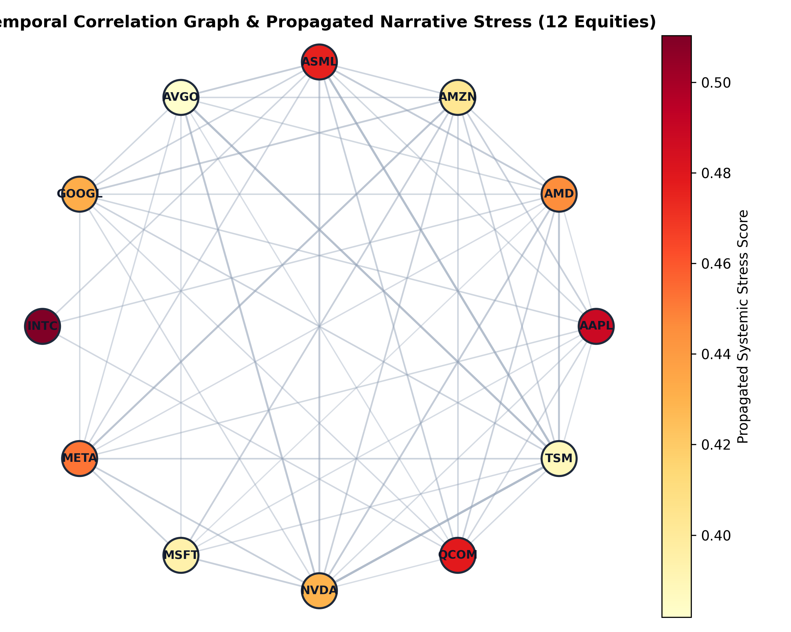<br/>
<sub><b>Figure 1. Graphe Temporel (12 Tickers, 53 Arêtes).</b> Propagation du stress narratif pré-cutoff.</sub><br/><br/>
<br/>
<sub><b>Figure 2. Courbes ROC & PR.</b> Détection hors-échantillon du régime de volatilité haute.</sub>
</td>
</tr>
</table>

---

### 8. [CBMX - Condition-Based Maintenance & Survival Intelligence](https://github.com/elm-as/CBMX)
> **Dépôt officiel** : [`elm-as/CBMX`](https://github.com/elm-as/CBMX) &bull; **Dashboard** : [`artifacts/dashboard.html`](https://github.com/elm-as/CBMX/blob/main/artifacts/dashboard.html) &bull; **Cible** : `Analyse de Survie Censurée à Droite & Politique RUL`

<table align="center">
<tr>
<td width="58%">

#### A. Problématique Industrielle & Asymétrie du Risque
En maintenance aéronautique, prédire la durée de vie résiduelle (*Remaining Useful Life - RUL*) d'un turboréacteur impose deux contraintes critiques : gérer la **censure à droite** des moteurs encore en service et refléter la forte **asymétrie économique** entre un remplacement prématuré (`1 500 EUR/unité`) et une panne non planifiée (`12 000 EUR/unité`).

#### B. Démarche & Pipeline NASA C-MAPSS FD001
1. **Données officielles (`download_cmapss.py`)** : Téléchargement des fichiers NASA C-MAPSS `FD001` (`100` moteurs d'entraînement / `20 631` cycles, `100` moteurs de test censurés à droite, `RUL_FD001.txt`).
2. **Features Causales & Validation `GroupKFold`** : Moyennes glissantes sur 5 cycles des `14` capteurs actifs (`groupby("unit_id")`), entraînement `LightGBM Regressor` sous **`GroupKFold` 5-folds par `unit_id`** (zéro fuite inter-moteurs).
3. **Survie & Politique Décisionnelle (`kaplan_meier.py` & `maintenance_policy.py`)** : Courbe de Kaplan-Meier sur les 200 moteurs (`66` paliers) et sélection du seuil d'intervention minimisant le coût total attendu.

#### C. Résultats Métriques Clés
- **Prédiction RUL (`100` moteurs `test_FD001`)** : **`18.31` cycles RMSE**, **`13.37` cycles MAE**, **`10.05` Score Asymétrique NASA**.
- **Analyse de Survie & Décision** : **`0.6057` Harrell's C-index**, **`66` paliers Kaplan-Meier**, coût optimal **`810.00 EUR/unité`** au seuil **`0.90`**.

#### D. Conclusion en Clair
> [!IMPORTANT]
> **Ce que montre l'étude concrètement** :
> 1. **Réparer un moteur juste avant la panne coûte beaucoup moins cher que d'attendre qu'il casse** : Une panne d'avion non planifiée coûte 8 fois plus cher (`12 000 EUR`) qu'une maintenance anticipée (`1 500 EUR`). Les capteurs permettent d'estimer combien de vols il reste à un moteur inconnu à 18 cycles près.
> 2. **Le bon moment pour intervenir fait tomber la facture** : En déclenchant la révision au bon seuil de risque, le coût moyen par moteur redescend à **810 EUR**, sans immobiliser les appareils trop tôt ni prendre le risque d'une casse en vol.

</td>
<td width="42%" align="center">
<br/>
<sub><b>Figure 1. Survie Kaplan-Meier (FD001).</b> Stratification par tercile de dégradation sous censure à droite.</sub><br/><br/>
<br/>
<sub><b>Figure 2. Prédictions RUL (100 Moteurs Test).</b> Parité & distribution des erreurs asymétriques NASA.</sub>
</td>
</tr>
</table>

---

### 9. [CHDCF - Clinical Heart Disease Calibration & Fairness (CDC BRFSS 2022)](https://github.com/elm-as/CHDCF)
> **Dépôt officiel** : [`elm-as/CHDCF`](https://github.com/elm-as/CHDCF) &bull; **Dashboard** : [`artifacts/dashboard.html`](https://github.com/elm-as/CHDCF/blob/main/artifacts/dashboard.html) &bull; **Cible** : `Épidémiologie Cardiovasculaire, Calibration Clinique & Équité`

<table align="center">
<tr>
<td width="58%">

#### A. Problématique Clinique & Enjeux Épidémiologiques
Sur la cohorte populationnelle américaine **CDC BRFSS 2022** (`246 022` adultes, prévalence d'infarctus `5.46 %`), la prédiction du risque cardiovasculaire se heurte à trois défis critiques : l'effet trompeur des proxys cliniques post-événement (`HadAngina`, `ChestScan`), la sous-détection catastrophique au seuil par défaut `0.50` (`20.39 %` de sensibilité) et le risque de disparités de calibration entre groupes démographiques.

#### B. Démarche & Architecture Calibration / Équité
1. **Ingestion Kaggle (`brfss_downloader.py`)** : Téléchargement et audit d'intégrité de `kamilpytlak/personal-key-indicators-of-heart-disease` (`246 022 × 40`, prétraitement strictement intra-pli).
2. **Calibration Imbriquée & Ablation des Proxys (`oof_calibrator.py`, `proxy_ablation_runner.py`)** : Comparaison `Full (39 vars)` (`LightGBM + Isotonic`) vs `Non-Proxy` (`LogisticRegression + Platt`) avec attribution SHAP.
3. **Audit d'Équité & Seuil Clinique `10:1` (`subgroup_fairness.py`, `threshold_optimizer.py`)** : Audit par `Sex`, `AgeCategory`, `RaceEthnicityCategory` et optimisation du seuil décisionnel sous coût asymétrique `10:1`.

#### C. Résultats Métriques Clés
- **Modèle Complet (`LightGBM + Isotonic`)** : **`0.8861` ROC-AUC**, **`0.4113` PR-AUC**, **`0.0391` Brier Score**, **`0.00017` ECE-10**.
- **Modèle Prévention Primaire sans Proxys (`LogReg + Platt`)** : **`0.8372` ROC-AUC**, **`0.2500` PR-AUC**, **`0.00268` ECE-10**.
- **Seuil Clinique Optimal (`0.0909`, coût `10:1`)** : **`68.60%` Sensibilité**, **`89.26%` Spécificité**, coût clinique réduit de `0.4423` à **`0.2730`**.

#### D. Conclusion en Clair
> [!IMPORTANT]
> **Ce que montre l'étude concrètement** :
> 1. **Un réglage standard rate 4 infarctus sur 5** : Avec un seuil classique à 50 %, l'algorithme ne détecte que 20 % des personnes à haut risque cardiaque. En abaissant le seuil au bon niveau de prudence (`9 %`), on repère **68.6 %** des cas à risque tout en gardant des examens complémentaires raisonnables.
> 2. **Prévenir avant les symptômes reste possible** : Même si on retire les signes déjà évidents (douleurs thoraciques, scanner déjà passé), l'âge, l'état de santé général, le diabète, le tabac et le sommeil permettent déjà d'identifier très efficacement les personnes à dépister tôt.

</td>
<td width="42%" align="center">
<br/>
<sub><b>Figure 1. Fiabilité & Calibration (246 022 Adultes).</b> ECE-10 abaissée à 0.00017.</sub><br/><br/>
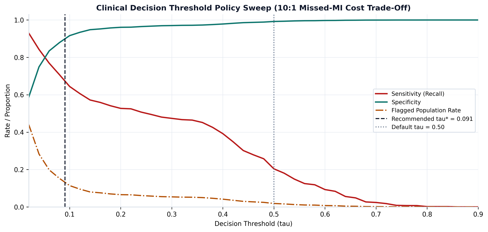<br/>
<sub><b>Figure 2. Optimisation Clinique (10:1).</b> Sensibilité de 68.60 % au seuil 0.0909.</sub>
</td>
</tr>
</table>

---

### 10. [CCARP - Credit Card Approval Risk & Expected Profit Optimization](https://github.com/elm-as/CCARP)
> **Dépôt officiel** : [`elm-as/CCARP`](https://github.com/elm-as/CCARP) &bull; **Dashboard** : [`artifacts/dashboard.html`](https://github.com/elm-as/CCARP/blob/main/artifacts/dashboard.html) &bull; **Cible** : `Scoring de Crédit Multi-Tables, Zéro Fuite Temporelle & Profit Net`

<table align="center">
<tr>
<td width="58%">

#### A. Problématique & Piège de la Fuite Temporelle Multi-Tables
Sur le jeu multi-tables `rikdifos/credit-card-approval-prediction` (`438 557` dossiers × `1 048 575` mois d'historique), la majorité des notebooks publics souffrent de deux fuites majeures : agrégation de l'historique futur dans les features (`AUC = 0.9988` illusoire) et présence de **`82.35 %` de clients dans des clusters démographiques multi-ID** (`6 943` groupes pour `17 220` dossiers).

#### B. Démarche & Validation `StratifiedGroupKFold` Sans Fuite
1. **Fenêtrage Temporel Strict (`t_obs = -12`)** : Séparation nette entre fenêtre d'observation ($\le -12$ mois) et fenêtre de performance ($[-11, 0]$), produisant une cohorte propre de `17 220` demandeurs (`156` défauts, `0.906 %`).
2. **Audit de Duplication & Ablation (`StratifiedGroupKFold`)** : Regroupement strict par empreinte démographique pour bloquer la mémorisation inter-plis.
3. **Optimisation du Profit Portefeuille** : Calibration *Platt* sur `CatBoost` et calcul de la courbe d'espérance de profit net par taux d'acceptation.

#### C. Résultats Métriques Clés
- **Leak-Free `StratifiedGroupKFold(5)`** : **`0.9267` ROC-AUC**, **`0.4081` PR-AUC**, **`0.0065` Brier Score**, **`0.0016` ECE-10**, **`0.6784` KS** (vs `0.9988` naïf avec fuite).
- **Politique de Profit Optimal (`CatBoost + Platt`)** : Seuil optimal **`0.070`** (`98.55 %` d'acceptation, taux de défaut approuvé divisé par 2 à **`0.418 %`**), générant **`2 935 320 €`** de profit portefeuille (**`170.46 €/demandeur`**).

#### D. Conclusion en Clair
> [!IMPORTANT]
> **Ce que montre l'étude concrètement** :
> 1. **Pour gagner plus, une banque n'a pas besoin de refuser tout le monde** : En refusant seulement les **1.45 %** de demandes de crédit les plus risquées (et en acceptant 98.55 % des clients), la banque divise par deux son taux d'impayés et maximise son gain total (**2.94 millions d'euros**).
> 2. **Beaucoup de modèles affichent 99 % par erreur** : Si l'on mélange l'historique futur du client ou les dossiers en double d'un même foyer dans l'entraînement, le modèle a l'air parfait sur le papier mais se trompe en agence. Un test propre montre sa vraie fiabilité.

</td>
<td width="42%" align="center">
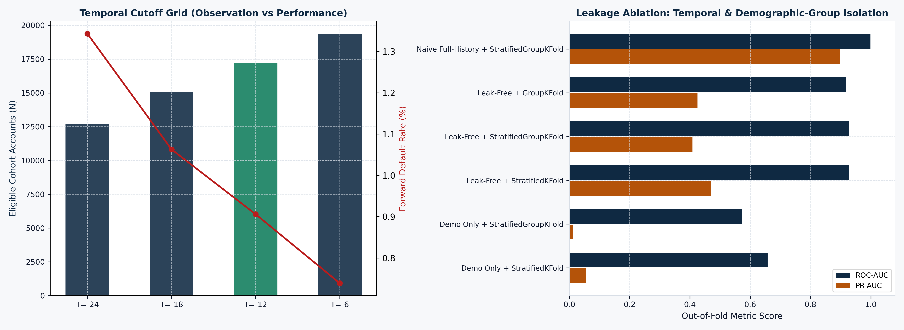<br/>
<sub><b>Figure 1. Ablation Temporelle & Multi-ID.</b> Écart entre protocole sans fuite (0.9267) et naïf (0.9988).</sub><br/><br/>
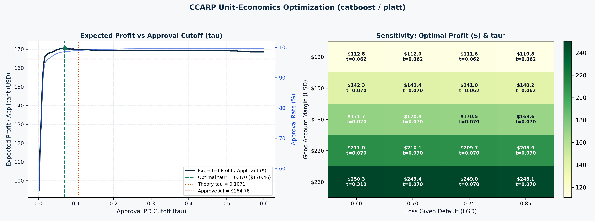<br/>
<sub><b>Figure 2. Courbe de Profit Net.</b> Optimum portefeuille à 2.94 M€ (170.46 €/demandeur).</sub>
</td>
</tr>
</table>

---

### 11. [BCCRI - Bank Customer Churn & Retention ROI Intelligence](https://github.com/elm-as/BCCRI)
> **Dépôt officiel** : [`elm-as/BCCRI`](https://github.com/elm-as/BCCRI) &bull; **Dashboard** : [`artifacts/dashboard.html`](https://github.com/elm-as/BCCRI/blob/main/artifacts/dashboard.html) &bull; **Cible** : `Attrition Bancaire, Audit de Fuite Post-Événement & ROI de Rétention`

<table align="center">
<tr>
<td width="58%">

#### A. Problématique & Détection de Fuite Post-Événement
Sur `radheshyamkollipara/bank-customer-churn` (`10 000` clients bancaires, taux d'attrition `20.38 %`), une variable piège - **`Complain`** - affiche une corrélation de **`r = 0.9957`** (`AUC univariée = 0.9984`) car la réclamation est enregistrée *au moment du départ*. L'objectif est d'auditer et purger cette fuite, isoler les leviers d'action réels via SHAP et maximiser le ROI net de rétention.

#### B. Démarche & Simulation Unit-Economics CLV
1. **Audit de Fuite Automatisé (`leakage_auditor.py`)** : Exclusion obligatoire de `Complain` (`MANDATORY_EXCLUDE_POST_EVENT_LEAKAGE`) et ablation auditée de `Satisfaction Score` (`r = -0.0058`).
2. **Benchmark Calibré & Partition SHAP (`stratified_benchmark.py`, `shap_lever_segmenter.py`)** : Validation croisée stratifiée 5-folds (`CatBoost`, `LightGBM`, etc.) et séparation du signal SHAP entre leviers actionnables (`52.2 %` : `NumOfProducts`, `IsActiveMember`, `Balance`) et contexte structurel.
3. **Simulation ROI de Rétention (`retention_roi_simulator.py`)** : Priorisation par espérance de valeur nette (`Net EV = p_cal * save_rate * CLV - cost`) comparée au classement par risque brut et au tirage aléatoire.

#### C. Résultats Métriques Clés
- **Modèle Purgé de Fuite (`CatBoost`, 5-Fold OOF)** : **`0.8694` ROC-AUC**, **`0.7126` PR-AUC**, **`0.6359` F1 optimal** (seuil `0.31`), **`0.09997` Brier Score**, **`0.0068` ECE**.
- **Simulation ROI Rétention (`EV / Lever-Targeted`)** : Optimum à **`25 %`** du portefeuille (`2 500` clients ciblés, `179.9` clients sauvés), générant **`+460 015 €` de gain net (`342.2 %` ROI)** - soit **`+19 929 €`** au-dessus d'un ciblage par risque pur.

#### D. Conclusion en Clair
> [!IMPORTANT]
> **Ce que montre l'étude concrètement** :
> 1. **Attendre qu'un client se plaigne, c'est déjà trop tard** : Les plaintes en banque arrivent au moment où le client ferme son compte. Pour agir avant son départ, les vrais signaux utiles sont son inactivité, le nombre de produits qu'il détient et l'évolution de son solde.
> 2. **Offrir un geste commercial au bon client rapporte gros** : En contactant uniquement les **25 %** de clients à la fois à risque et récupérables (au lieu d'arroser tout le monde), la banque sauve environ 180 clients et gagne **+460 000 EUR nets** (plus de 3 fois la mise).

</td>
<td width="42%" align="center">
<br/>
<sub><b>Figure 1. Audit de Fuite & Partition SHAP.</b> Purge de Complain (r=0.9957) et 52.2 % de leviers actionnables.</sub><br/><br/>
<br/>
<sub><b>Figure 2. Frontière ROI de Rétention.</b> Gain net de +460 015 € (342.2 % ROI) à 25 % de ciblage.</sub>
</td>
</tr>
</table>

---

### 12. [SCLDO - Supply Chain Late-Delivery & SLA Risk Intelligence (Olist 9 Tables)](https://github.com/elm-as/SCLDO)
> **Dépôt officiel** : [`elm-as/SCLDO`](https://github.com/elm-as/SCLDO) &bull; **Dashboard** : [`artifacts/dashboard.html`](https://github.com/elm-as/SCLDO/blob/main/artifacts/dashboard.html) &bull; **Cible** : `Supply Chain E-Commerce, Risque de Retard Pré-Expédition & Politique SLA`

<table align="center">
<tr>
<td width="58%">

#### A. Problématique & Enjeux Opérationnels
Sur le jeu relationnel réel `olistbr/brazilian-ecommerce` (**9 tables**, `99 441` commandes brutes → **`96 470` commandes livrées valides**, taux de retard `8.11 %`), comment anticiper les retards *avant expédition* sans fuite de dates transporteur (`order_delivered_carrier_date`), quantifier l'effet causal réel du retard sur la satisfaction client (`note 1★`), et optimiser les interventions SLA proactives sous coût asymétrique ?

#### B. Démarche & Validation Chronologique Sans Fuite
1. **Jointure 9 Tables & Historique Vendeur Passé Pur** : Distance géodésique Haversine (`99.51 %` de couverture sur `19 010` codes postaux géolocalisés), ratio fret/prix, délai promis et taux de retard vendeur strictement antérieur (`shift(1)` chronologique).
2. **Split Out-of-Time Strict & Ablation Fuite Transporteur** : Entraînement `≤ 2018-04-30` (`71 118` commandes, `8.79 %` retards), test hors-temps `2018-05 → 2018-08` (`25 352` commandes, `6.21 %`), CV temporelle expansive 5 plis et calibration isotonique imbriquée.
3. **Économétrie Causale Retard → Note `1★` & Politique SLA `8:1`** : Standardisation sur 9 groupes de confondants + contre-vérification IPW (120 réplications bootstrap, `n = 95 824`) et optimisation de seuil (`C_proactive = 10 R$` vs `C_loss = 80 R$`).

#### C. Résultats Métriques Clés
- **Modèle Pré-Expédition Propre (`LightGBM` OOT)** : **`0.7346` ROC-AUC**, **`0.1291` PR-AUC**, **`0.0574` Brier**, **`0.0093` ECE-10** (vs **`0.8456` ROC-AUC / `+0.1110` illusoire** lorsque `order_delivered_carrier_date` fuit).
- **Falaise Causale Note `1★`** : **`6.59 %`** à l'heure → **`14.37 %`** (`+7.78 pp`) à `1-3j` → **`52.74 %`** (**`+46.15 pp`**) à `4-7j` → **`66.72 %`** (**`+60.13 pp`**) au-delà de `7j`.
- **Politique SLA Optimale (`τ* = 0.130`)** : **`48.00 %`** de rappel (`21.38 %` ciblées), économisant **`2 477 R$` / 10 000 commandes** (vs `0.00 %` de rappel au seuil `0.50`).

#### D. Conclusion en Clair
> [!IMPORTANT]
> **Ce que montre l'étude concrètement** :
> 1. **Jusqu'à 3 jours de retard, le client pardonne encore ; à partir du 4e jour, il sanctionne** : Un colis arrivé à l'heure reçoit 6.6 % de notes 1 étoile. Entre 1 et 3 jours de retard, on monte à 14.4 %. Mais dès **4 à 7 jours de retard**, plus d'un client sur deux (**52.7 %**) met 1 étoile, et **2 clients sur 3 (66.7 %)** au-delà d'une semaine.
> 2. **Prévenir le client avant qu'il ne s'énerve rapporte de l'argent** : On peut repérer les commandes à risque dès l'achat (selon le délai promis, la distance et l'historique du vendeur). Envoyer un message proactif ou un geste sur les 21 % de commandes les plus fragiles fait économiser **2 477 R$ par tranche de 10 000 commandes**.

</td>
<td width="42%" align="center">
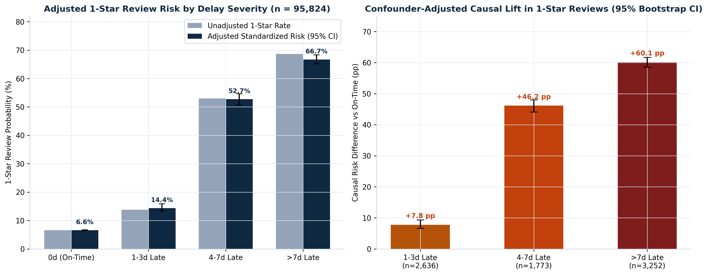<br/>
<sub><b>Figure 1. Effet Causal Retard → Note 1★.</b> Basculement brutal à +46.2 pp (4-7j) et +60.1 pp (>7j).</sub><br/><br/>
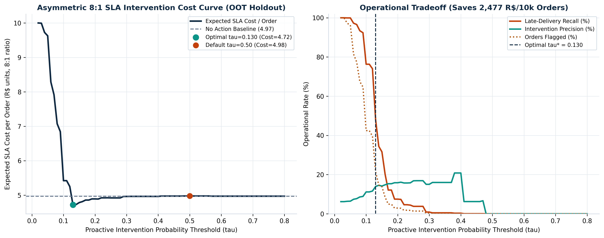<br/>
<sub><b>Figure 2. Optimisation SLA 8:1.</b> Économie nette de 2 477 R$ / 10 000 commandes au seuil τ* = 0.130.</sub>
</td>
</tr>
</table>

---

### 13. [HREOP - Hospital 30-Day Readmission & Clinical Triage Optimization (130 US Hospitals)](https://github.com/elm-as/HREOP)
> **Dépôt officiel** : [`elm-as/HREOP`](https://github.com/elm-as/HREOP) &bull; **Dashboard** : [`artifacts/dashboard.html`](https://github.com/elm-as/HREOP/blob/main/artifacts/dashboard.html) &bull; **Cible** : `Réadmission Hospitalière à 30 Jours, GroupKFold Patient & Capacité Infirmière HRRP`

<table align="center">
<tr>
<td width="58%">

#### A. Problématique Clinique & Double Piège Méthodologique
Sur les `101 766` séjours hospitaliers réels de 130 hôpitaux américains (`brandao/diabetes`, `71 518` patients uniques), deux biais invalident la majorité des modèles publiés : la **censure de mortalité** (inclure les patients décédés ou transférés en soins palliatifs, impossibles à réadmettre) et la **fuite d'identité patient** (`46.0 %` des séjours proviennent de `16 341` patients récurrents qui se retrouvent à la fois en train et en validation sous split aléatoire).

#### B. Démarche & Optimisation Capacitaire HRRP
1. **Purge de Mortalité/Hospice & Mapping ICD-9** : Exclusion stricte de **`2 423` séjours** (`discharge_disposition_id ∈ {11,13,14,19,20,21}`), cohorte survivante de **`99 343` séjours / `69 990` patients** (`11.39 %` réadmis `<30j`), mapping ICD-9 en groupes cliniques CCS.
2. **Audit de Fuite `StratifiedGroupKFold` vs `StratifiedKFold` Naïf** : **`0.00 %`** de chevauchement patient contre **`41.57 %`** (`14 214` patients partagés) en split naïf, avec calibration imbriquée `5×3` Platt & Isotonic.
3. **Politique Infirmière de Transition & Équité** : Optimisation sous contrainte de capacité hospitalière (Top `5 %`-`20 %`, réadmission `$12 000` vs suivi `$600`, efficacité `30 %`) et audit d'équité (`gender`, `race`, `age`).

#### C. Résultats Métriques Clés
- **Meilleur Modèle Sans Fuite (`LightGBM`, Patient `GroupKFold`)** : **`0.6787` ROC-AUC**, **`0.2365` PR-AUC**, **`0.09549` Brier**, **`0.00236` ECE-10** (`HistGradientBoosting + Isotonic` atteint `0.00048` ECE-10) ; fuite naïve quantifiée jusqu'à **`+0.00431` PR-AUC**.
- **Optimum Capacitaire HRRP (Top `15 %`, `τ = 0.1745`)** : **`14 902`** sorties suivies, **`32.81 %`** de sensibilité, **`24.91 %` PPV (`2.19×` lift)**, **`1 114`** réadmissions évitées, **`+$4 422 000` d'économie nette (`ROI +0.49×`)** - tandis que Top `5 %` culmine à `ROI +1.08×` (`PPV 34.60 %`, `3.04×` lift).

#### D. Conclusion en Clair
> [!IMPORTANT]
> **Ce que montre l'étude concrètement** :
> 1. **Un patient qui a déjà enchaîné les séjours à l'hôpital a 3 à 4 fois plus de risque d'y revenir dans le mois** : Le taux de retour rapide passe de **8.2 %** chez un patient sans séjour récent à **28.1 %** dès 3 hospitalisations antérieures. Le mode de sortie et les ajustements d'insuline sont aussi des signaux forts.
> 2. **Mieux vaut bien suivre les 15 % les plus fragiles que vouloir appeler tout le monde** : En concentrant les appels infirmiers après la sortie sur les **15 %** de patients les plus à risque, l'hôpital évite **1 114 réadmissions** et économise **4.42 millions de dollars nets**, alors qu'un suivi massif sans ciblage ferait perdre de l'argent.

</td>
<td width="42%" align="center">
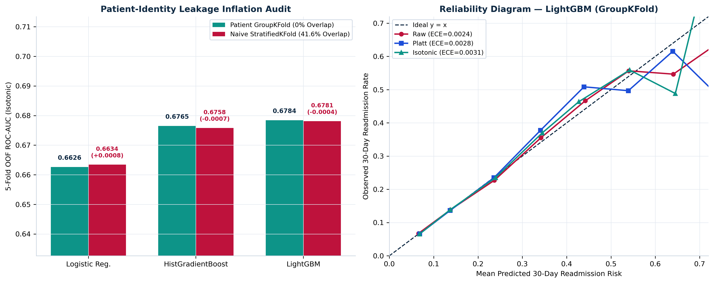<br/>
<sub><b>Figure 1. Audit de Fuite Patient & Calibration.</b> 0.00 % de chevauchement en GroupKFold vs 41.57 % en split naïf.</sub><br/><br/>
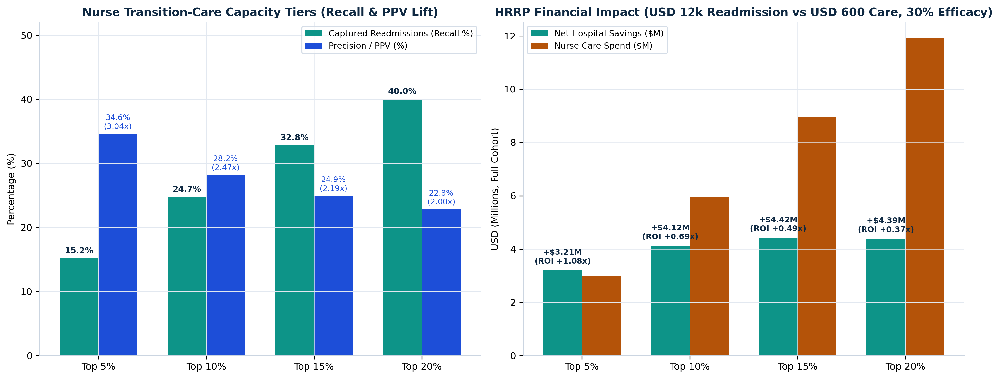<br/>
<sub><b>Figure 2. Économie Capacitaire HRRP.</b> Pic d'économie nette à +$4.42M au Top 15 % des sorties.</sub>
</td>
</tr>
</table>

---

### 14. [NIDSZ - Network Intrusion Detection & Zero-Day Generalization (UNSW-NB15)](https://github.com/elm-as/NIDSZ)
> **Dépôt officiel** : [`elm-as/NIDSZ`](https://github.com/elm-as/NIDSZ) &bull; **Dashboard** : [`artifacts/dashboard.html`](https://github.com/elm-as/NIDSZ/blob/main/artifacts/dashboard.html) &bull; **Cible** : `Cybersécurité Réseau, Généralisation Zero-Day (LOAO) & Contrainte Anti-Fatigue SOC`

<table align="center">
<tr>
<td width="58%">

#### A. Problématique Cybersécurité & Illusion des Scores Globaux
Sur le benchmark réseau réel `UNSW-NB15` (**`257 673` flux** : `175 341` train officiel / `82 332` holdout test officiel, 9 familles d'attaques), un `ROC-AUC` global de `0.98+` masque deux réalités critiques d'un vrai SOC : la **fatigue d'alerte** (un FPR de `5 %` inonde les analystes de milliers de fausses alertes/heure) et l'effondrement sur les **familles d'attaques jamais vues (*zero-day*)**.

#### B. Démarche : Ablation Raccourcis Lab, LOAO Zero-Day & Budget FPR `0.1 %`
1. **Partition Officielle & Audit d'Ablation (`Full-34` vs `Behavioral-24`)** : Zéro mélange train/test (`25.33 %` de chevauchement exact inter-splits audité) et retrait de `10` raccourcis d'en-têtes/tables du banc d'essai (`state`, `swin`, `ct_dst_sport_ltm`… représentant `13.11 %` du SHAP global).
2. **Protocole *Leave-One-Attack-Family-Out* (LOAO)** : Entraînement en retirant *intégralement* chacune des 7 familles majeures (`Backdoor`, `DoS`, `Worms`, `Exploits`, `Reconnaissance`, `Fuzzers`, `Shellcode`) pour mesurer le vrai rappel *zero-day* face aux `37 000` flux `Normal` du test.
3. **Points de Fonctionnement SOC & Latence** : Évaluation stricte à **`FPR ≤ 0.1 %`**, `0.5 %`, `1.0 %` + benchmark débit temps réel (`flux/sec`, `µs/flux`).

#### C. Résultats Métriques Clés
- **Holdout Officiel (`82 332` flux, `LightGBM + Platt OOF`)** : **`0.9810` ROC-AUC**, **`0.9864` PR-AUC**, **`80.77 %` Recall @ FPR ≤ 0.1 %**, **`86.43 %` @ 1.0 %**, **`100 688` flux/sec (`9.93 µs/flux`)**.
- **Modèle Comportemental Pur (`Behavioral-24`)** : **`0.9809` ROC-AUC**, **`85.08 %` @ 0.5 % FPR**, **`142 948` flux/sec (`7.00 µs/flux`)**, et **améliore la détection zero-day** sur `Exploits` (`+3.33 pp` @ 0.1 % FPR), `Worms` (`+2.27 pp`) et `Fuzzers` (`+0.0256` AUC).
- **Hétérogénéité Zero-Day LOAO (@ 1.0 % FPR)** : `Backdoor` **`96.40 %`**, `DoS` **`90.93 %`**, `Worms` **`79.55 %`**, mais chute sévère sur `Shellcode` (**`27.25 %`**, `5.03 %` @ 0.1 % FPR) et `Fuzzers` (`24.17 %`) ; `IsolationForest` non supervisé plafonne à `< 7 %`.

#### D. Conclusion en Clair
> [!IMPORTANT]
> **Ce que montre l'étude concrètement** :
> 1. **On peut bloquer 8 attaques sur 10 sans saturer l'équipe de sécurité** : Le détecteur arrête **80.8 %** des intrusions tout en gardant moins d'une fausse alerte pour 1 000 connexions normales, et analyse jusqu'à **143 000 connexions par seconde**.
> 2. **Aucune IA réseau seule n'arrête toutes les attaques inédites** : Face à une famille d'attaque jamais rencontrée avant, le modèle repère très bien les portes dérobées (`96 %`) et saturations DoS (`91 %`), mais rate la majorité des attaques discrètes de type `Shellcode` ou `Fuzzers`. En cybersécurité, il faut toujours plusieurs barrières complémentaires.

</td>
<td width="42%" align="center">
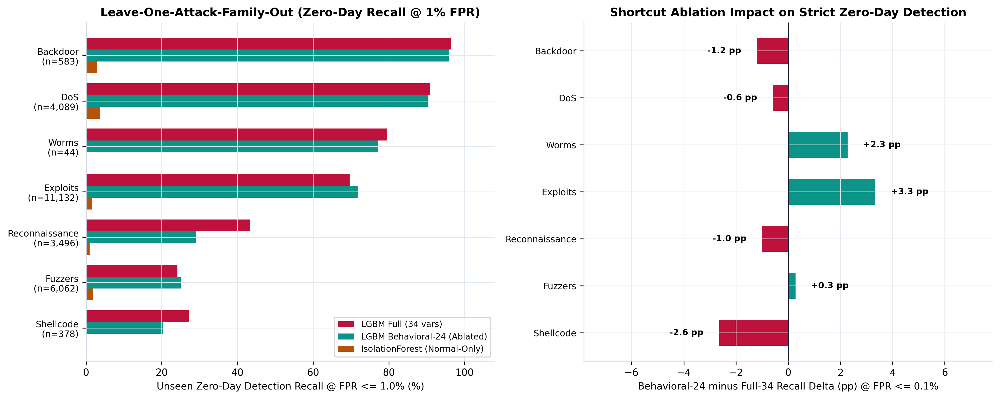<br/>
<sub><b>Figure 1. Généralisation Zero-Day (LOAO).</b> Rappel sur familles d'attaques jamais vues et gain d'ablation comportementale.</sub><br/><br/>
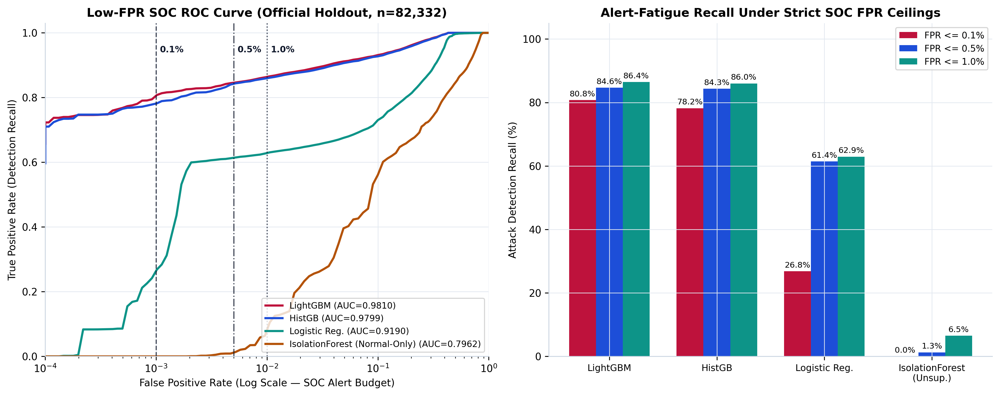<br/>
<sub><b>Figure 2. Frontière Anti-Fatigue SOC.</b> 80.77 % de rappel à FPR ≤ 0.1 % avec calibration Platt OOF.</sub>
</td>
</tr>
</table>

---

### 15. [AGCRS - Global Agricultural Yield, Climate Shocks & Parametric Crop Insurance](https://github.com/elm-as/AGCRS)
> **Dépôt officiel** : [`elm-as/AGCRS`](https://github.com/elm-as/AGCRS) &bull; **Dashboard** : [`artifacts/dashboard.html`](https://github.com/elm-as/AGCRS/blob/main/artifacts/dashboard.html) &bull; **Cible** : `Sécurité Alimentaire, Stress-Test Climatique & Assurance Agricole Paramétrique Conforme`

<table align="center">
<tr>
<td width="58%">

#### A. Problématique Agronomique & Bug Caché de Duplication Multi-Stations
Sur le panel FAO/Banque Mondiale (`patelris/crop-yield-prediction-dataset`, `28 242` lignes brutes sur `101` pays et `10` cultures vivrières majeures - dont `Maize`, `Cassava`, `Sorghum`, `Yams`, `Plantains`, `Rice, paddy`), un piège caché corrompt l'écrasante majorité des études publiques : une jointure multi-stations duplique jusqu'à **`22×`** le même `(Pays, Culture, Année)` (Inde `22×`, Brésil `11×`), gonflant le jeu de **`+115 %`** et créant une fuite triviale en validation croisée.

#### B. Démarche : Déduplication Stricte, Économétrie Climatique & Prédiction Conforme
1. **Audit & Purge du Panel** : Réduction de `28 242` → **`13 130` observations uniques `(Area, Item, Year)`** (**`-53.51 %`** de lignes redondantes supprimées) et détection de l'invariance temporelle de la pluie annuelle moyenne FAO.
2. **Validation Out-of-Time (`2011-2013`) & Spatiale *Leave-One-Region-Out* (6 régions FAO)** : `Ridge Fixed-Effects (α=50)` vs `HistGradientBoosting` vs `LightGBM` sur lags strictement passés, puis **Split-Conformal Adaptatif 90 %**.
3. **Stress-Test `+2 °C` / `-20 %` Sécheresse & Assurance Paramétrique** : Modèle semi-log quadratique à effets fixes et simulation d'une assurance indicielle déclenchée sous `80 %` du rendement local historique.

#### C. Résultats Métriques Clés
- **Prévision Hors-Temps `2011-2013` (`Ridge Fixed-Effects`)** : **`R² = 0.9658`**, **`RMSE = 16 314.7 hg/ha`**, **`MAE = 7 722.8`**, **`MAPE = 15.02 %`** ; **LORO 6 régions** : `R² moyen = 0.9536` (`Afrique subsaharienne` 26 pays : `R² = 0.9256`).
- **Intervalles Conformes Adaptatifs 90 %** : Couverture empirique **`89.77 %`** avec largeur médiane réduite de **`-33.7 %`** (`24 959 hg/ha`) et stabilité par culture (`Cassava 90.24 %`, `Maize 89.45 %`, `Yams 90.32 %`).
- **Vulnérabilité Climatique & Assurance Paramétrique** : Le **Sorgho** (`-4.82 %` à `+2 °C`, `-6.29 %` en sécheresse `-20 %`) et le **Maïs** (`-7.39 %` en sécheresse) sont les céréales vivrières les plus exposées ; l'**Afrique subsaharienne** affiche le plus haut taux de sinistre (`11.43 %`, prime pure `3.83 %`, risque de base FN `7.80 %`).

#### D. Conclusion en Clair
> [!IMPORTANT]
> **Ce que montre l'étude concrètement** :
> 1. **La sécheresse frappe d'abord le maïs et le sorgho, surtout en Afrique subsaharienne** : Quand la pluie baisse de 20 %, les récoltes de maïs chutent en moyenne de **7.4 %** et celles de sorgho de **6.3 %**. L'Afrique subsaharienne subit le plus haut taux de mauvaises récoltes sévères (**11.4 %** des saisons).
> 2. **Une assurance météo basée seulement sur la moyenne de l'année ne protège pas assez les agriculteurs** : Elle laisse passer près de **8 %** de vraies mauvaises récoltes sans indemnisation en Afrique. Pour qu'une assurance agricole soit juste, il faut suivre la pluie mois par mois pendant la saison de pousse, pas uniquement le cumul annuel.

</td>
<td width="42%" align="center">
<br/>
<sub><b>Figure 1. Stress-Test Climatique (+2 °C / -20 % Pluie).</b> Sensibilité des cultures vivrières africaines et mondiales.</sub><br/><br/>
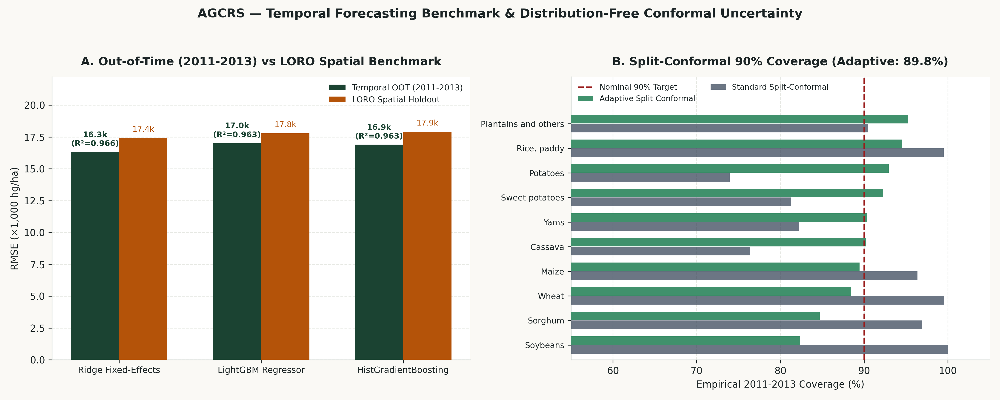<br/>
<sub><b>Figure 2. Prévision Hors-Temps & Conformal Adaptatif.</b> R² = 0.9658 et couverture 89.77 % (-33.7 % de largeur).</sub>
</td>
</tr>
</table>

---

## Synthèse Comparative des Enseignements & Conclusions Déclaratives

Le tableau suivant récapitule les enseignements empiriques fondamentaux dégagés par chaque système :

| Projet | Domaine d'Application | Volume de Données | Modèles Centraux | Métrique Clé | Conclusion Scientifique Définitive |
|---|---|---|---|---|---|
| **PCCF** | Détection de Fraude | 1 000 000 transactions | Spline-GLM + GBDT + Nelder-Mead | **0.95331 ROC-AUC** (#26 Top 2.0%) | Les générateurs CTGAN laissent une empreinte décimale exploitable ; l'assemblage multi-familles bat tout modèle unitaire. |
| **GGVCF** | Économétrie Causale | 95 pays (3 120 obs) | Two-Way FE PanelOLS + RF | **$\rho = -0.0026$** ($p = 0.980$) | La saturation en armes civiles n'explique pas le taux d'homicides ; l'inégalité de Gini ($59.8\%$) est le moteur déterminant. |
| **Pneumonia** | IA Clinique Pédiatrique | 5 856 radiographies | ResNet-18 + Tête MLP + Youden | **99.23% Sensibilité** (390 cas) | La perte asymétrique garantit zéro omission virale (100%) ; Grad-CAM valide les foyers de condensation anatomiques. |
| **GCMDL** | Microstructure Crypto | 1 000 crypto-actifs | Soft-Voting GBDT + Youden | **0.9996 Tail-Risk AUC** | Un faible ratio de flottant avec fort overhang FDV prédit à 99.9% un effondrement supérieur à -85% du pic. |
| **ISML** | Chronobiologie & Dépression | 6 532 sujets (113 pays) | GBDT Pondéré + Youden + OLS | **0.9962 Dépression AUC / 98.69% Acc** | Le ratio écran/sommeil > 1.0 déclenche +179% de stress ; l'activité physique constitue un bouclier protecteur (-84% de dépression). |
| **ERGF** | Énergie & Prix Spot | 8 784 heures (DE-LU 2024) | DML Merit-Order + Conformal | **`-3.176 €/GW` · 90.88% PICP** | Chaque GW renouvelable comprime causalement le prix spot ; 457 h de prix négatifs observées. |
| **FINSG** | NLP & Risque Systémique | 501j · 240 dépêches · 12 titres | Scorer Lexical + Graphe Temporel | **0.6250 ROC-AUC · 0.6571 Macro-F1** | La propagation sur graphe pré-cutoff capture la contagion sectorielle sans fuite temporelle. |
| **CBMX** | Survie & Maintenance | 200 moteurs (NASA FD001) | LightGBM GroupKFold + KM | **18.31 RMSE · 10.05 NASA Score** | La maintenance optimisée au seuil 0.90 réduit le coût attendu à 810 €/unité. |
| **CHDCF** | Épidémiologie Cardiaque | 246 022 adultes (BRFSS) | LightGBM + Isotonic + SHAP | **0.8861 AUC · 0.00017 ECE** | La calibration isotonique au seuil 0.0909 triple la sensibilité clinique (68.60 %) tout en auditant les proxys et l'équité. |
| **CCARP** | Scoring Crédit | 17 220 dossiers (multi-tables) | CatBoost + Platt + GroupKFold | **0.9267 AUC · 2.94 M€ Profit** | Le fenêtrage `t_obs = -12` et le groupement multi-ID éliminent la fuite (0.9988 → 0.9267) et optimisent le profit net. |
| **BCCRI** | Rétention & CLV | 10 000 clients bancaires | CatBoost + SHAP + Net EV | **0.8694 AUC · +460 k€ (342% ROI)** | Purger `Complain` (r=0.9957) et cibler par Net EV surpasse le classement par risque brut de +19 929 €. |
| **SCLDO** | Supply Chain & SLA | 96 470 commandes (Olist 9 tables) | LightGBM OOT + Causal IPW | **0.7346 AUC · +46.2 pp (4-7j)** | La falaise causale `1★` s'ouvre dès J+4 (+46.2 pp) ; l'alerte SLA 8:1 économise 2 477 R$ / 10k commandes. |
| **HREOP** | Clinique & Triage HRRP | 99 343 séjours (69 990 patients) | LightGBM Patient GroupKFold | **0.6787 AUC · +$4.42M HRRP** | Purger décès/hospice et grouper par patient élimine 41.57 % de fuite ; le Top 15 % maximise l'économie nette. |
| **NIDSZ** | Cybersécurité Zero-Day | 257 673 flux (UNSW-NB15) | LightGBM Platt + LOAO | **80.77% @ 0.1% FPR · 143k/s** | L'ablation des raccourcis lab accélère le débit (+42 %) et renforce le zero-day `Exploits`/`Worms`, mais `Shellcode` reste fragile. |
| **AGCRS** | Agronomie & Climat | 13 130 panel unique (101 pays) | Ridge FE + Conformal Adaptatif | **0.9658 R² · 89.77% PICP** | Dédupliquer -53.51 % révèle la vraie résilience ; Sorgho & Maïs subissent le choc sécheresse (-6.3 % à -7.4 %) et l'Afrique un risque FN de 7.80 %. |

---

## Protocole de Gouvernance & Synchronisation Multi-Dépôts

L'orchestration des dépôts satellites et la cohérence de livraison entre le hub maître et les sous-modules sont régies par le protocole strict défini dans **[`WORKFLOW.md`](./WORKFLOW.md)** :

1. **Synchronisation ascendante obligatoire** : Tout entraînement, correction de code ou ajout d'artefact dans un sous-projet déclenche obligatoirement :
   - La validation de la suite de tests unitaires locale (`pytest`).
   - Le rafraîchissement des graphiques 300 DPI dans `images/`.
   - La synchronisation du pointeur de commit Git dans le hub parent `DataScience/`.
   - La mise à jour du tableau de bord et des conclusions dans ce `README.md`.
2. **Standard de publication complet** : Tout projet comporte un en-tête métrique, des diagrammes Mermaid sans balises HTML conflictuelles, des figures graphiques nettes et un notebook Jupyter autonome de reproduction.

---

## Clonage & Reproduction Intégrale

Pour cloner l'ensemble du hub et l'intégralité de ses 15 sous-modules en une seule commande :

```bash
git clone --recurse-submodules https://github.com/elm-as/DataScience.git
cd DataScience
```

Si le dépôt principal est déjà cloné localement :
```bash
git submodule update --init --recursive
```

---

## La Charte de Développement ElmasCore

Consultez **[`ELMAS.md`](./ELMAS.md)** pour le manifeste complet des règles de développement d'ElmasCore :
- Limite stricte de **350 lignes maximum par fichier** dans les modules applicatifs. Faites pas chier avec vos fichiers à +1000 lignes
- Fonctions pures, déterministes et sans effets de bord.
- Découpage par domaine métier et typage statique systématique.

---

<div align="center">
<sub>Hub souverain développé par <b>ElmasCore Research & Engineering</b> - "From Data to Systems"</sub><br/>
<sub>Auteur : <b>Elmas Tresor Oulobo</b> ([@elm-as](https://github.com/elm-as))</sub>
</div>
