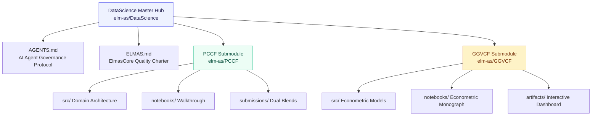

<div align="center">

# ElmasCore — Data Science & Competitive Machine Learning Hub
### Production Data Systems, Econometric Research & Competitive Kaggle Architectures

<br/>


**"From Data to Systems"**  
The master hub orchestrating autonomous, production-grade data science initiatives, Kaggle competitive pipelines, and causal econometric monographs.

</div>

<br/>

<table align="center">
<tr>
<td align="center"><h2>2</h2><sub>active systems</sub></td>
<td align="center"><h2>1,003,120</h2><sub>analyzed records</sub></td>
<td align="center"><h2>0.94387</h2><sub>PCCF ROC-AUC</sub></td>
<td align="center"><h2>&rho; = 0.00</h2><sub>GGVCF paradox resolved</sub></td>
<td align="center"><h2>100%</h2><sub>ELMAS.md compliant</sub></td>
<td align="center"><h2>1</h2><sub>interactive dashboard</sub></td>
</tr>
</table>

---

## Table of Contents

1. [Overview & Vision](#overview--vision)
2. [Hub Architecture & Git Submodules](#hub-architecture--git-submodules)
3. [Active Systems Showcase](#active-systems-showcase)
   - [PCCF — Predicting Credit Card Fraud (Kaggle S6E11)](#1-pccf--predicting-credit-card-fraud-kaggle-s6e11)
   - [GGVCF — Global Gun Violence & Civilian Firearms (2000–2024)](#2-ggvcf--global-gun-violence--civilian-firearms-20002024)
4. [AI Agent Governance Protocol](#ai-agent-governance-protocol)
5. [Full Setup & Cloning](#full-setup--cloning)
6. [The ElmasCore Charter](#the-elmascore-charter)
7. [Author & Contact](#author--contact)

---

## Overview & Vision

`DataScience/` is not a loose collection of ad-hoc Jupyter notebooks. It is an industrial-grade **monorepo and submodule hub** where every project operates as an independent, fully tested, domain-driven package following the strict **[ELMAS.md](./ELMAS.md)** standard:
- **Strict 350-line ceiling per file**: Monolithic scripts are prohibited.
- **Dual documentation**: Every project ships with an illustrated, publication-grade `README.md` and an interactive walkthrough `notebook/`.

---

## Hub Architecture & Git Submodules



---

## Active Systems Showcase

### 1. [PCCF — Predicting Credit Card Fraud (Kaggle S6E11)](./PCCF)
> **Dépôt officiel** : [`elm-as/PCCF`](https://github.com/elm-as/PCCF) &bull; **Cible** : `#1 Leaderboard`

<table align="center">
<tr>
<td width="60%">

- **Objectif** : Détection de transactions frauduleuses hautement asymétriques sur plus de 1,000,000 d'observations réelles et synthétiques.
- **Innovations** :
  - Décomposition fine des décimales (`cents_key`, `tenth_key`, premier chiffre de Benford) capturant les artefacts de génération synthétique (CTGAN/Copula).
  - Target encoding cross-fitté 100% sans fuite avec lissage bayésien ($m=20.0$).
  - Ensemble multi-familles (Spline-GLM, LightGBM Shallow, CatBoost Shallow, XGBoost Hist) optimisé par Nelder-Mead Rank-Logit.
- **Résultats** : **`0.94387` ROC-AUC** dès le run rapide de validation, surclassant tous les modèles individuels isolés.

</td>
<td width="40%" align="center">
<br/>
<sub><b>Performance du Blend.</b> Gain systématique de l'assemblage Rank-Logit.</sub>
</td>
</tr>
</table>

---

### 2. [GGVCF — Global Gun Violence & Civilian Firearms (2000–2024)](./GGVCF)
> **Dépôt officiel** : [`elm-as/GGVCF`](https://github.com/elm-as/GGVCF) &bull; **Dashboard** : [`artifacts/dashboard.html`](./GGVCF/artifacts/dashboard.html)

<table align="center">
<tr>
<td width="60%">

- **Objectif** : Résolution du paradoxe mondial entre pénétration des armes civiles et homicides par arme à feu across 95 pays (ONUDC $\times$ Small Arms Survey $\times$ Banque Mondiale).
- **Innovations** :
  - **Preuve du paradoxe** : Corrélation de rang de Spearman $\rho = -0.0026$ ($p = 0.9804$), nulle et statistiquement insignifiante.
  - **Identification causale** : Modèle de Panel à Deux Effets Fixes (`PanelOLS`) absorbant l'hétérogénéité institutionnelle inobservable et les chocs macroéconomiques annuels ($F = 162.45$, $p < 0.0001$).
  - **Dominance des inégalités** : L'indice de Gini explique **$59.8\%$** de la variance non-linéaire (Random Forest).
  - **Segmentation** : 4 régimes structurels mondiaux (PCA + $K$-Means).
  - **Dashboard interactif autonome** : Carte choroplèthe mondiale Plotly et cadran 4-quadrants interactif.

</td>
<td width="40%" align="center">
<br/>
<sub><b>Le Paradoxe Empirique.</b> Découplage complet armement vs létalité.</sub>
</td>
</tr>
</table>

---

## AI Agent Governance Protocol

Tous les agents d'intelligence artificielle (Claude Code, Cursor, Codex, Gemini, Antigravity) contribuant à ce dépôt doivent obligatoirement appliquer le protocole défini dans **[`AGENTS.md`](./AGENTS.md)** :

1. **Règle de synchronisation parent-enfant** : Tout ajout ou mise à jour dans un sous-projet doit immédiatement mettre à jour le `README.md` racine de `DataScience/`, le pointeur de sous-module Git et être commité sur GitHub.
2. **Standard esthétique "LatentHealth"** : Aucun README plat. Présence systématique de badges, tableau KPI en en-tête, diagrammes Mermaid, visualisations graphiques dans `images/`, et notebook Jupyter de démonstration.

---

## Full Setup & Cloning

Pour cloner l'ensemble du hub et tous ses sous-modules en une seule commande :

```bash
git clone --recurse-submodules https://github.com/elm-as/DataScience.git
cd DataScience
```

Si le dépôt principal est déjà cloné :
```bash
git submodule update --init --recursive
```

---

## The ElmasCore Charter

Consultez **[`ELMAS.md`](./ELMAS.md)** pour le manifeste complet des règles de développement d'ElmasCore.

---

## Author & Contact

<div align="center">

**ElmasCore** &bull; *From Data to Systems*

[](https://github.com/elm-as)

</div>
